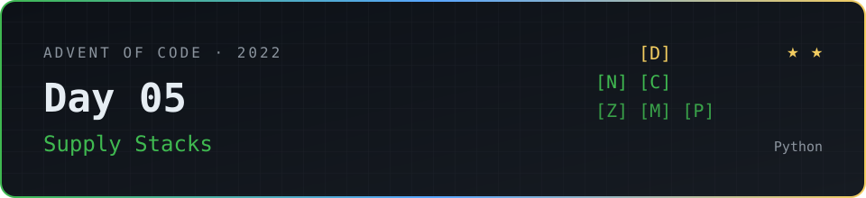
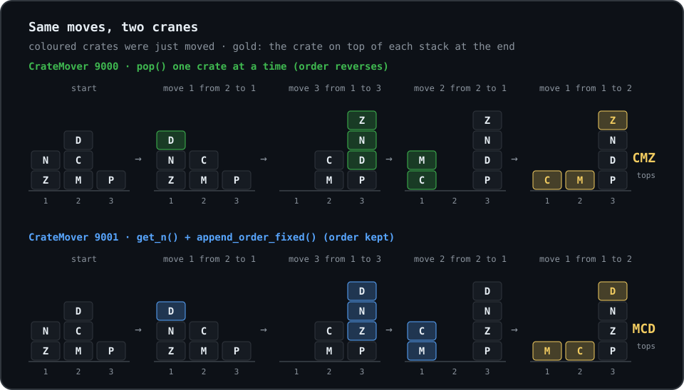

<div align="center">
  
</div>

> [!IMPORTANT]
> **The code was written 100% by a human.** Every line of the solutions in this repository was written by hand, without any kind of help from artificial intelligence: no generated code, no hints, no suggestions.
> AI was only used afterwards, to turn that finished, hand-written code into this README (the text and the diagrams).

## 🧩 The puzzle

The input starts with a drawing of stacks of crates (`[A]`, `[B]`, ...) above a line of stack numbers,
followed by a list of moves like `move 3 from 1 to 3`. A crane runs the moves.

| Part | Question |
| :--: | -------- |
| ⭐ 1 | With a CrateMover 9000, which lifts **one crate at a time**, which crates end up on top of each stack? |
| ⭐ 2 | With a CrateMover 9001, which lifts **several crates at once**, which crates end up on top? |

## 💡 The idea

The hard part is reading the drawing; after that it is plain stack simulation.

1. **Find the number line.** The first line whose text starts with `1` holds the stack numbers. The
   column of each digit is exactly the column where that stack's letters sit in the drawing.
2. **Build the stacks bottom-up.** Walk the drawing from the number line upwards and, for every
   stack column, push the letter found there (if any).
3. **Run the moves.** Part 1 pops one crate and pushes it, `amount` times, so a group arrives
   upside down. Part 2 slices the top `amount` crates and appends them as a block, so the order is kept.
4. **Read the tops** of all stacks and join them into a string.

<div align="center">
  
</div>

## 🛠️ Implementations

| Language | Highlights |
| -------- | ---------- |
| [Python](./python) | A small `Stack` class wraps a list. `get_indexing_zone` finds the number line and the column of every stack, `get_stacks` fills two independent copies of the stacks, and one loop over the moves updates both: `pop()`/`append()` for part 1 and `get_n()`/`append_order_fixed()` for part 2. |

```python
for amount, origin, destination in moves:
    stacks_part_two[destination].append_order_fixed(stacks_part_two[origin].get_n(amount))

    for _ in range(amount):
        stacks_part_one[destination].append(stacks_part_one[origin].pop())
```

## ⏱️ Complexity

With `m` moves of up to `k` crates:

| | Time | Memory |
| - | :--: | :----: |
| Part 1 | `O(m · k)` | `O(number of crates)` |
| Part 2 | `O(m · stack size)` (list slicing) | `O(number of crates)` |

## ▶️ Running

`main.py` reads `./test.txt` by default and `./input.txt` when `run` is passed as an argument.

```bash
cd python && python3 main.py run    # Python, real input
cd python && python3 main.py        # Python, example
```
