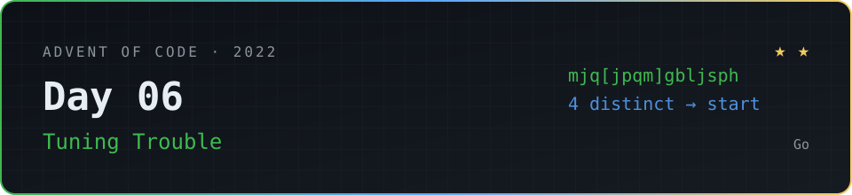
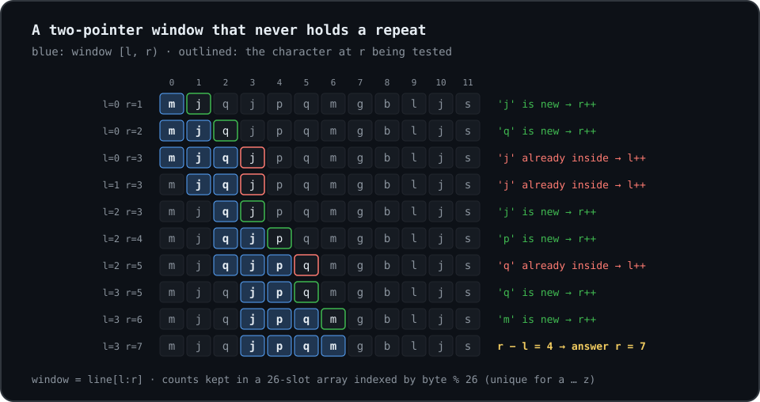

<div align="center">
  
</div>

> [!IMPORTANT]
> **The code was written 100% by a human.** Every line of the solutions in this repository was written by hand, without any kind of help from artificial intelligence: no generated code, no hints, no suggestions.
> AI was only used afterwards, to turn that finished, hand-written code into this README (the text and the diagrams).

## 🧩 The puzzle

The input is one long line of lowercase letters: a signal from the elves' communication device.
A marker is a run of characters that are all different.

| Part | Question |
| :--: | -------- |
| ⭐ 1 | How many characters are read before the first run of **4** different characters ends? |
| ⭐ 2 | Same question for the first run of **14** different characters. |

## 💡 The idea

Both parts are the same function with a different window size, so the code has one `solve(reader, windowSize)`.

The code keeps a **sliding window** `[l, r)` that never contains a repeated letter, plus a count per letter:

- If the next letter `line[r]` is **not** in the window, take it: count it and move `r` right.
- If it **is** already in the window, drop the leftmost letter (uncount it and move `l` right) and try again.
- Stop as soon as the window is `windowSize` wide. Then `r` is the number of characters read.

Each pointer only moves forward, so the whole scan is linear.

<div align="center">
  
</div>

## 🛠️ Implementations

Go, with the code kept directly in the day folder.

| File | Highlights |
| ---- | ---------- |
| [solve.go](./solve.go) | The two-pointer window. Letters are counted in a 26-slot array indexed by `byte % 26`: the 26 lowercase ASCII codes are consecutive, so their remainders are all different. |
| [one.go](./one.go) · [two.go](./two.go) | Call `solve` with a window of 4 and 14. |
| [main.go](./main.go) | Reads `./input.txt` with the author's [`aocreader`](https://github.com/marcos-venicius/aocreader) package. |
| [utils.go](./utils.go) | A small integer `max` helper. |
| [one_test.go](./one_test.go) · [two_test.go](./two_test.go) | The public examples as table tests. |

```go
for r-l < windowSize {
	if arr[line[r]%26] > 0 {
		arr[line[l]%26] = max(0, arr[line[l]%26]-1)
		l++
	} else {
		arr[line[r]%26]++
		r++
	}
}

ans = r
```

## ⏱️ Complexity

| | Time | Memory |
| - | :--: | :----: |
| Both parts | `O(n)`: `l` and `r` each move at most `n` times | `O(1)` (26 counters) |

## ▶️ Running

The program reads `./input.txt` from the day folder.

```bash
go run .     # Go
go test      # run the example tests
```
