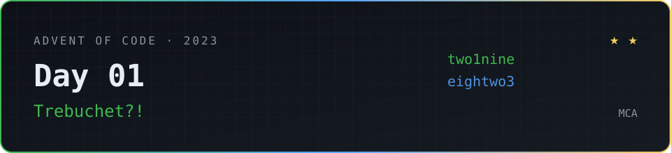
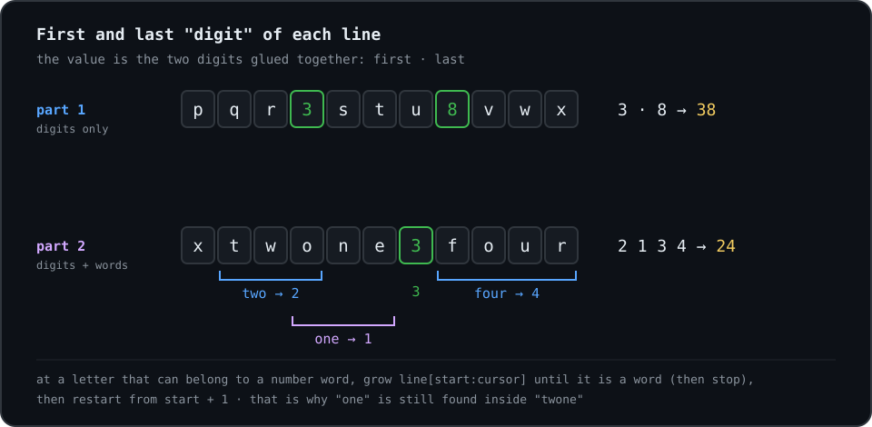

<div align="center">
  
</div>

> [!IMPORTANT]
> **The code was written 100% by a human.** Every line of the solutions in this repository was written by hand, without any kind of help from artificial intelligence: no generated code, no hints, no suggestions.
> AI was only used afterwards, to turn that finished, hand-written code into this README (the text and the diagrams).

## 🧩 The puzzle

Each line of the calibration document hides a two-digit value: the first digit of the line followed by the last one.

| Part | Question |
| :--: | -------- |
| ⭐ 1 | Using only the digits `0`–`9`, what is the sum of all calibration values? |
| ⭐ 2 | Spelled-out numbers (`one` … `nine`) count as digits too. What is the new sum? |

## 💡 The idea

**Part 1** collects every digit character of the line and glues the first and the last.

**Part 2** scans the line with a cursor. A digit is taken as is. At a letter that can be part of a number word,
the scanner grows a slice from that position until the slice is one of the nine words (or a letter that cannot be
part of any word appears). Whatever happened, the cursor then goes back to the **next** position after the start,
because words can share letters: `twone` holds both `two` and `one`, and `eightwo` holds `eight` and `two`.

<div align="center">
  
</div>

## 🛠️ Implementations

| Language | Highlights |
| -------- | ---------- |
| [MCA](./mca) | Written in the author's own language [MCA](https://github.com/marcos-venicius/MCA). `number_letters` is a `set` of every letter used by the number words, built by splitting `onetwothreefourfivesixseveneightnine`, and `numbers_mapping` is a word → value dictionary. `get_calibration` handles part 1, `parse_calibration` part 2; each value is built with `string.format(first, last)` and `as_int`. The file is read separately for each part. |

```
while cursor < size and contains(number_letters, line[cursor]) {
  cursor += 1

  if contains(numbers_mapping, line[start:cursor]) {
    append(numbers, numbers_mapping[line[start:cursor]])

    break;
  }
}

# words may overlap ('eightwo'), so rescan from the next character
cursor = start
```

## ⏱️ Complexity

With `n` lines of length up to `L`:

| | Time | Memory |
| - | :--: | :----: |
| Part 1 | `O(n · L)` | `O(L)` per line |
| Part 2 | `O(n · L²)` in the worst case (a slice can grow from every start) | `O(L)` per line |

## ▶️ Running

The solution reads `input.txt` from the current directory.

```bash
cd mca && mca main.mca
```
