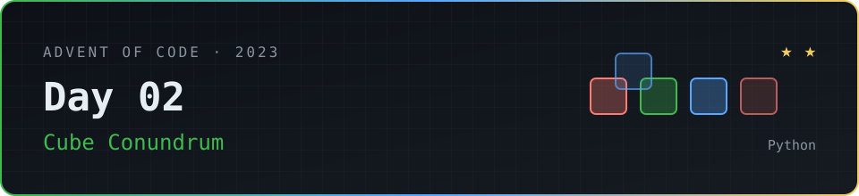
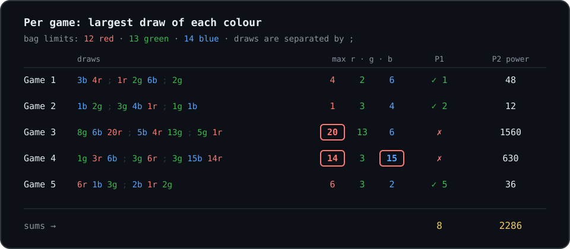

<div align="center">
  
</div>

> [!IMPORTANT]
> **The code was written 100% by a human.** Every line of the solutions in this repository was written by hand, without any kind of help from artificial intelligence: no generated code, no hints, no suggestions.
> AI was only used afterwards, to turn that finished, hand-written code into this README (the text and the diagrams).

## 🧩 The puzzle

An Elf plays games with a bag of red, green and blue cubes. In each game he grabs a few handfuls (separated by `;`)
and shows them, like `Game 1: 3 blue, 4 red; 1 red, 2 green, 6 blue; 2 green`.

| Part | Question |
| :--: | -------- |
| ⭐ 1 | Which games are possible if the bag held only `12` red, `13` green and `14` blue cubes? Sum their IDs. |
| ⭐ 2 | For each game, find the fewest cubes of each colour that make it possible and multiply them (the *power*). Sum the powers. |

## 💡 The idea

Everything comes down to the **largest handful of each colour** in a game.

- **Part 1**: a game is possible when no single handful asks for more cubes of a colour than the bag has.
- **Part 2**: the smallest bag that works holds exactly the maximum seen for each colour, so the power is the product of those maxima.

<div align="center">
  
</div>

## 🛠️ Implementations

| Language | Highlights |
| -------- | ---------- |
| [Python](./python) | `parse_line` walks the whitespace-split tokens in pairs (amount, colour) and starts a new handful when a colour ends with `;`. Part 1 subtracts each handful from a global `bag` dict and fails if any count goes below zero; `restore_bag` refills the bag after every handful and also serves as the early `return False`. Part 2 keeps the maximum per colour in a `cubes` dict and multiplies its values together. A `TEST` flag (set to `False`) chooses between `test.txt` and `input.txt`. |

```python
def is_game_possible(game):
    for subset in game['subsets']:
        for key, value in subset.items():
            if bag[key] - value < 0:
                return restore_bag(False)

            bag[key] -= value

        restore_bag()

    return True
```

## ⏱️ Complexity

With `k` colour counts in the whole input:

| | Time | Memory |
| - | :--: | :----: |
| Part 1 | `O(k)` | `O(k)` for the parsed games |
| Part 2 | `O(k)` | `O(1)` per game |

## ▶️ Running

The solution reads `input.txt` from the current directory.

```bash
cd python && python3 main.py
```
