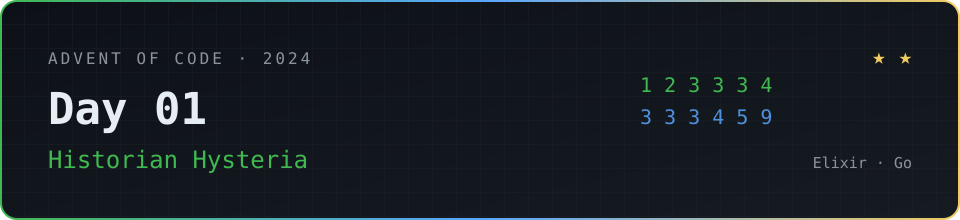
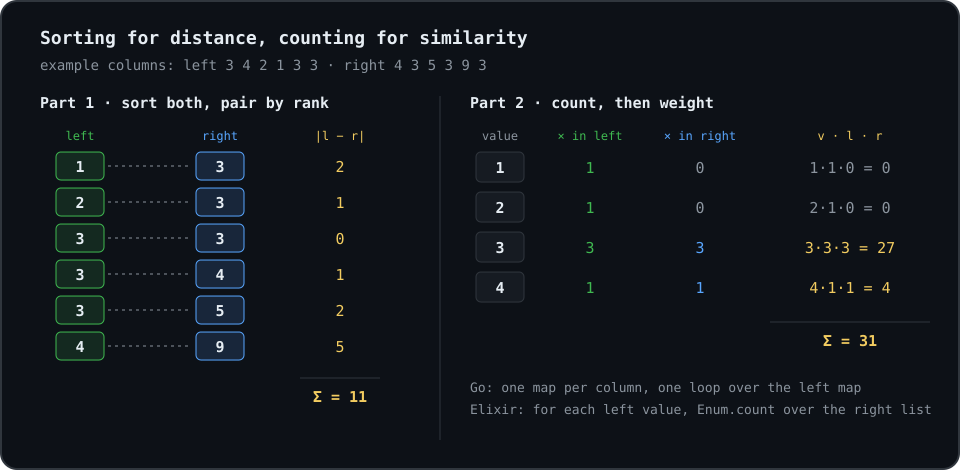

<div align="center">
  
</div>

> [!IMPORTANT]
> **The code was written 100% by a human.** Every line of the solutions in this repository was written by hand, without any kind of help from artificial intelligence: no generated code, no hints, no suggestions.
> AI was only used afterwards, to turn that finished, hand-written code into this README (the text and the diagrams).

## 🧩 The puzzle

The historians have two lists of location IDs, written side by side as two columns of numbers.

| Part | Question |
| :--: | -------- |
| ⭐ 1 | Pair the smallest number on the left with the smallest on the right, the second smallest with the second smallest, and so on. What is the sum of the distances between the pairs? |
| ⭐ 2 | Multiply each number on the left by how many times it appears on the right. What is the sum (the similarity score)? |

## 💡 The idea

- **Part 1** is a sort: once both columns are sorted, the pairs are simply the rows, and the answer is the
  sum of `|left − right|` over the rows.
- **Part 2** is a count: knowing how often each value appears in the right column, every left value
  contributes `value × count_right(value)`.

<div align="center">
  
</div>

## 🛠️ Implementations

| Language | Highlights |
| -------- | ---------- |
| [Go](./go) | `parseLine` reads the two numbers with a regex. Part 1 collects two slices, sorts them with `sort.Slice` and adds up `abs(left[i] - right[i])`. Part 2 builds a count map for each column and adds `k * v * right[k]` for every key `k` of the left map, so each distinct value is handled once. Tests cover the public example. |
| [Elixir](./elixir) | A pipeline: `extract_digits` uses `Regex.run` and `Enum.reduce` to build both lists and sorts them, `diff` zips them into distances and a recursive `sum` adds them. Part 2 (`calc_score`) walks the left list recursively and uses `Enum.count` on the right list for each element. Errors are carried as `{:error, _}` tuples through the pipeline. |

```go
for k, v := range left {
	similarityScore += k * v * right[k]
}
```

## ⏱️ Complexity

| | Time | Memory |
| - | :--: | :----: |
| Part 1 | `O(n log n)` (sorting) | `O(n)` |
| Parsing (Elixir) | `O(n²)`: each line is appended with `++` | `O(n)` |
| Part 2 (Go) | `O(n)` with maps | `O(n)` |
| Part 2 (Elixir) | `O(n²)`: one `Enum.count` over the right list per left value | `O(n)` |

## ▶️ Running

Each solution reads `input.txt` from the current directory (its own language folder).

```bash
cd go     && go run .         # Go
cd go     && go test          # Go, example tests
cd elixir && elixir aoc.exs   # Elixir
```
