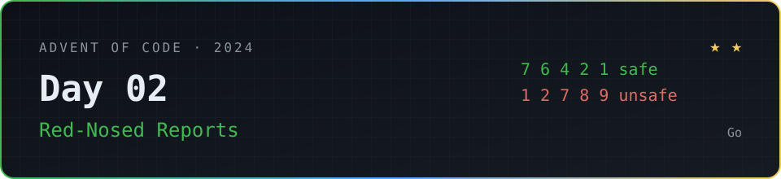
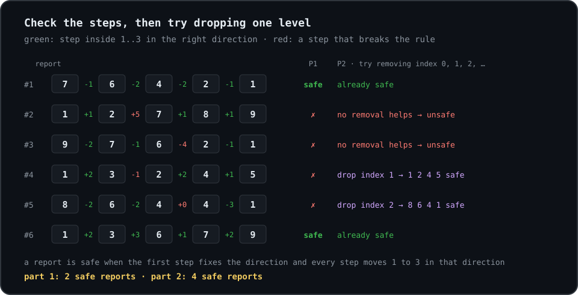

<div align="center">
  
</div>

> [!IMPORTANT]
> **The code was written 100% by a human.** Every line of the solutions in this repository was written by hand, without any kind of help from artificial intelligence: no generated code, no hints, no suggestions.
> AI was only used afterwards, to turn that finished, hand-written code into this README (the text and the diagrams).

## 🧩 The puzzle

Each line of the input is a report: a list of numbers called levels. A report is **safe** when the levels
are all increasing or all decreasing, and every two neighbours differ by at least 1 and at most 3.

| Part | Question |
| :--: | -------- |
| ⭐ 1 | How many reports are safe? |
| ⭐ 2 | How many reports are safe if you may remove one single level from each report? |

## 💡 The idea

- **Part 1**: the first two levels decide the direction (equal means unsafe right away). Then every
  step must go in that direction by 1 to 3.
- **Part 2**: if a report is not safe, try it again without level 0, then without level 1, and so on.
  The first copy that is safe makes the report count. Reports are short, so this brute force is cheap.

<div align="center">
  
</div>

## 🛠️ Implementations

Go, with the code kept directly in the day folder.

| File | Highlights |
| ---- | ---------- |
| [lib.go](./lib.go) | `parseLine` pulls the numbers with a regex. `isSafe` sets an `INC`/`DEC` state from the first pair and checks every step with the helpers `inc(a, b)` and `dec(a, b)`. |
| [one.go](./one.go) | Counts the reports where `isSafe` is true. |
| [two.go](./two.go) | For an unsafe report, builds a new slice without index `i` (`parsedLine[:i]` + `parsedLine[i+1:]`) and stops at the first safe one. |
| [main.go](./main.go) | Reads `./input.txt` with the author's [`aocreader`](https://github.com/marcos-venicius/aocreader) package and resets the reader between the parts. |
| [one_test.go](./one_test.go) · [two_test.go](./two_test.go) | The public example. |

```go
for i := 0; i < len(parsedLine); i++ {
	newline := []int{}
	newline = append(newline, parsedLine[:i]...)
	newline = append(newline, parsedLine[i+1:]...)

	if isSafe(newline) {
		ans += 1
		break
	}
}
```

## ⏱️ Complexity

With `n` reports of `k` levels:

| | Time | Memory |
| - | :--: | :----: |
| Part 1 | `O(n · k)` | `O(k)` |
| Part 2 | `O(n · k²)` in the worst case | `O(k)` |

## ▶️ Running

The program reads `./input.txt` from the day folder.

```bash
go run .     # Go
go test      # example tests
```
