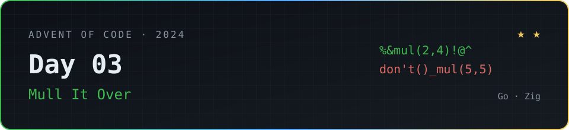
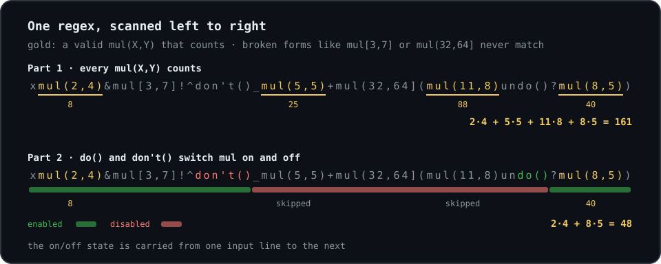
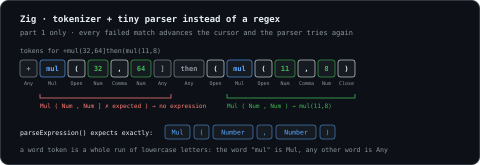

<div align="center">
  
</div>

> [!IMPORTANT]
> **The code was written 100% by a human.** Every line of the solutions in this repository was written by hand, without any kind of help from artificial intelligence: no generated code, no hints, no suggestions.
> AI was only used afterwards, to turn that finished, hand-written code into this README (the text and the diagrams).

## 🧩 The puzzle

The input is a piece of corrupted program memory. Hidden in the noise are instructions like `mul(X,Y)`,
where `X` and `Y` are numbers; anything slightly different (`mul[3,7]`, `mul(4*`, `mul ( 2 , 4 )`) is
just garbage.

| Part | Question |
| :--: | -------- |
| ⭐ 1 | What is the sum of the results of every valid `mul(X,Y)`? |
| ⭐ 2 | `do()` enables and `don't()` disables the following `mul` instructions (they start enabled). What is the sum of the enabled ones? |

## 💡 The idea

This is a scanning problem: walk through the text from left to right and pick up the pieces that match.

- **Part 1**: find every `mul\((\d+),(\d+)\)` and add up `X * Y`.
- **Part 2**: look for three things in a single pass, `mul(...)`, `do()` and `don't()`, and keep an
  `enabled` flag. A `mul` only counts while the flag is on. The flag is kept from one input line to the
  next.

<div align="center">
  
</div>

The Zig version does part 1 without regular expressions: a hand-written tokenizer and a tiny parser.

<div align="center">
  
</div>

## 🛠️ Implementations

| Language | Highlights |
| -------- | ---------- |
| [Go](./go) | Both parts use `regexp`. Part 1 uses `mul\((\d+),(\d+)\)`. Part 2 uses one alternation, `(mul\((\d+),(\d+)\))\|(don't\(\))\|(do\(\))`, and switches on the full match. `parseCompleteExpressions` takes the current state and returns the final one, so `solveTwo` carries it across lines. Tests cover both public examples. |
| [Zig](./zig) | **Part 1 only.** `tokenizer.zig` turns the text into `Mul`, `OpenParen`, `CloseParen`, `Comma`, `Number` and `Any` tokens (a run of lowercase letters is one word token, and only the word `mul` becomes `Mul`). `parser.zig` tries to `expect` the sequence `Mul ( Number , Number )` at the cursor; when it fails, the cursor moves on by one token and it tries again. `lib.zig` reads the file into an `ArrayList(u8)`. |

```go
switch match[0] {
case "don't()":
	enabled = false
case "do()":
	enabled = true
default:
	if !enabled {
		break
	}
	// ... keep mul(left, right)
}
```

## ⏱️ Complexity

| | Time | Memory |
| - | :--: | :----: |
| Go, both parts | `O(n)` regex scan | `O(m)` for the `m` matches |
| Zig, part 1 | `O(n)` tokenize + `O(t)` parse | `O(t)` for the `t` tokens |

## ▶️ Running

Both versions read `../input.txt`, so the input file lives in the day folder and the programs are run from
their own language folder.

```bash
cd go  && go run .         # Go
cd go  && go test          # Go, example tests
cd zig && zig run main.zig # Zig (part 1)
```
