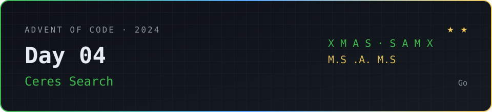
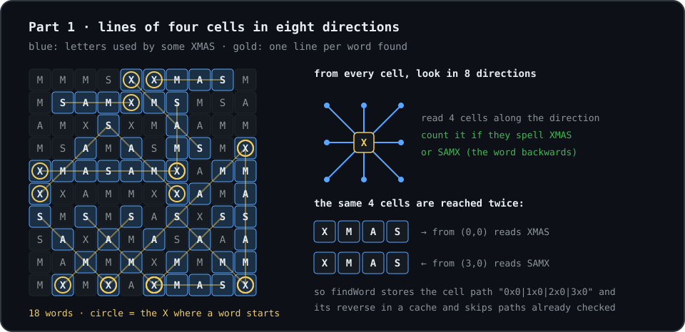
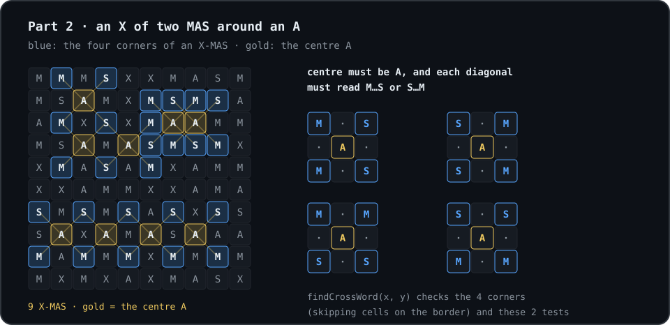

<div align="center">
  
</div>

> [!IMPORTANT]
> **The code was written 100% by a human.** Every line of the solutions in this repository was written by hand, without any kind of help from artificial intelligence: no generated code, no hints, no suggestions.
> AI was only used afterwards, to turn that finished, hand-written code into this README (the text and the diagrams).

## 🧩 The puzzle

An elf needs help with a word search: a grid of the letters `X`, `M`, `A` and `S`.

| Part | Question |
| :--: | -------- |
| ⭐ 1 | How many times does `XMAS` appear? Words can go horizontally, vertically or diagonally, forwards or backwards, and may overlap. |
| ⭐ 2 | How many times do two `MAS` words cross in the shape of an X (both diagonals through the same `A`)? |

## 💡 The idea

### Part 1 · straight lines of four cells

From every cell, look along the 8 directions and read the 4 letters there. If they spell `XMAS`, or
`SAMX` (the same word backwards), that line is a hit.

Reading both spellings means that each line of four cells can be found twice: once from one end and once
from the other. The Go version keeps a cache of the cell paths it has already checked (for example
`0x0|1x0|2x0|3x0` and its reverse), so every line is checked and counted only once.

<div align="center">
  
</div>

### Part 2 · an X around an A

Every X-MAS has an `A` in the middle. For each cell that is not on the border and holds an `A`, look at
the four diagonal neighbours: the top-left/bottom-right pair must be one `M` and one `S`, and so must the
top-right/bottom-left pair.

<div align="center">
  
</div>

## 🛠️ Implementations

| Language | Highlights |
| -------- | ---------- |
| [Go](./go) | `getInput` cuts the file into rows at each `\n` without copying it. `findWord` walks one direction, counts matches against `XMAS` and against its reverse at the same time, and uses `createCacheKeys` to skip cell paths already seen. `findCrossWord` checks the bounds, the centre `A` and the two diagonals. |

```go
at := in.data[topLeftY][topLeftX]
ab := in.data[bottomRightY][bottomRightX]

a := at == 'M' && ab == 'S' || at == 'S' && ab == 'M'

bt := in.data[topRightY][topRightX]
bb := in.data[bottomLeftY][bottomLeftX]

b := bt == 'M' && bb == 'S' || bt == 'S' && bb == 'M'

return a && b
```

## ⏱️ Complexity

For a `w × h` grid:

| | Time | Memory |
| - | :--: | :----: |
| Part 1 | `O(w · h · 8)` checks, each building string keys | `O(w · h)` cached keys |
| Part 2 | `O(w · h)` | `O(1)` extra |

## ▶️ Running

The program reads `../input.txt`, so the input file lives in the day folder.

```bash
cd go && go run .    # Go
```
