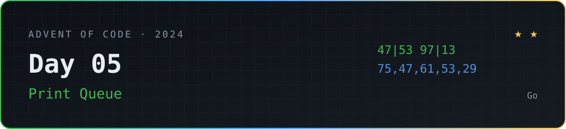
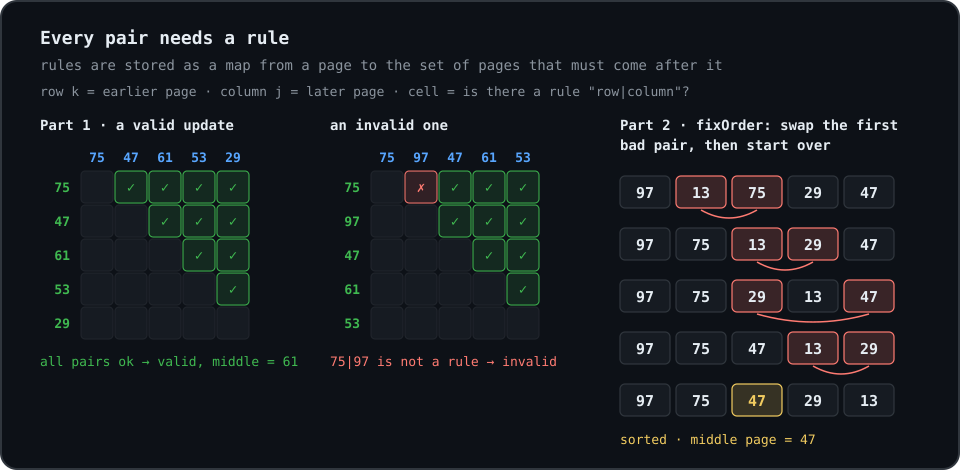

<div align="center">
  
</div>

> [!IMPORTANT]
> **The code was written 100% by a human.** Every line of the solutions in this repository was written by hand, without any kind of help from artificial intelligence: no generated code, no hints, no suggestions.
> AI was only used afterwards, to turn that finished, hand-written code into this README (the text and the diagrams).

## 🧩 The puzzle

The input has two sections. First come page ordering rules like `47|53` (if both pages are printed,
47 must come before 53). After a blank line come updates: lists of page numbers like `75,47,61,53,29`.

| Part | Question |
| :--: | -------- |
| ⭐ 1 | Which updates are already in the right order? Add up their middle page numbers. |
| ⭐ 2 | Put the wrongly ordered updates in the right order and add up their middle page numbers. |

## 💡 The idea

Store the rules as a map from a page to the **set of pages that must come after it**. Then:

- **Check an update** by looking at every pair of positions `k < j`: the page at `k` must have a rule
  saying it comes before the page at `j`. One missing rule makes the update wrong.
- **Fix an update** by finding the first bad pair, swapping the two pages, and starting the check again
  from the beginning. Repeat until no bad pair is left, then take the middle page.

<div align="center">
  
</div>

## 🛠️ Implementations

| Language | Highlights |
| -------- | ---------- |
| [Go](./go) | `ParseLine` switches from rules to updates at the empty line. Rules live in `map[int]map[int]struct{}`. `getCorrectUpdatesIndexes` and `getIncorrectUpdatesIndexes` run the pair check and return indexes. `fixOrder` swaps the first bad pair in place and calls itself again, and `sumIndexes` adds the middle pages. Tests cover the public example for both parts. |

```go
if _, ok := in.rules[array[k]][update]; !ok {
	array[k], array[i] = array[i], array[k]

	in.fixOrder(index)
	return
}
```

## ⏱️ Complexity

With `u` updates of up to `k` pages:

| | Time | Memory |
| - | :--: | :----: |
| Part 1 | `O(u · k²)` | `O(rules)` |
| Part 2 | `O(k²)` per restart, with up to `O(k²)` swaps per update | `O(rules)` plus the recursion depth |

## ▶️ Running

The program reads `../input.txt`, so the input file lives in the day folder.

```bash
cd go && go run .    # Go
cd go && go test     # example tests
```
