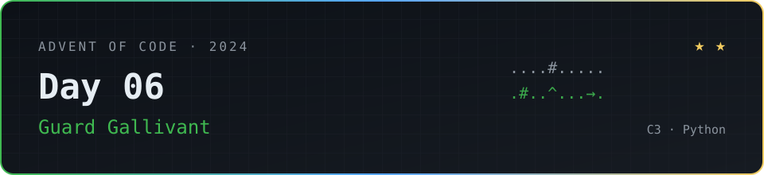
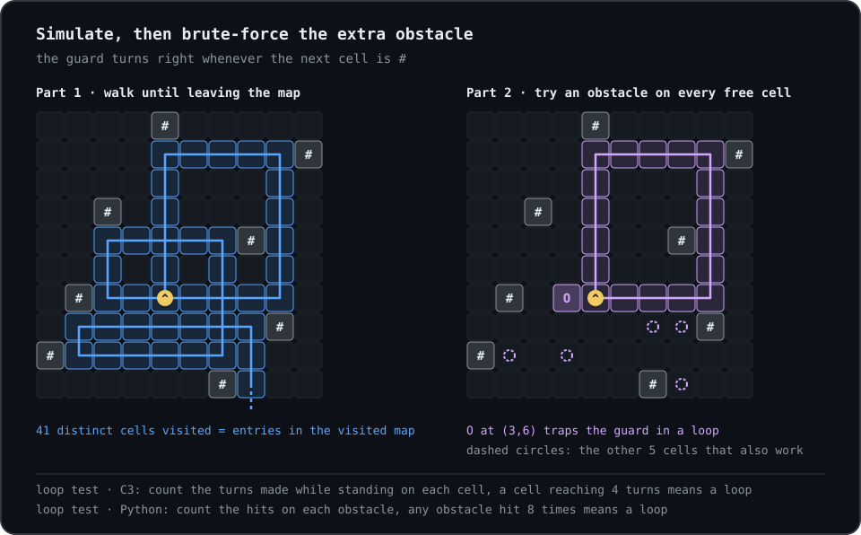

<div align="center">
  
</div>

> [!IMPORTANT]
> **The code was written 100% by a human.** Every line of the solutions in this repository was written by hand, without any kind of help from artificial intelligence: no generated code, no hints, no suggestions.
> AI was only used afterwards, to turn that finished, hand-written code into this README (the text and the diagrams).

## 🧩 The puzzle

A guard patrols a map of free cells `.` and obstacles `#`. She starts at `^` facing up, walks
forward, and every time the next cell is an obstacle she turns 90° to the right. Sooner or later she
walks off the map.

| Part | Question |
| :--: | -------- |
| ⭐ 1 | How many distinct cells does the guard visit before leaving the map? |
| ⭐ 2 | On how many cells could one new obstacle be placed so that the guard gets stuck in a loop forever? |

## 💡 The idea

- **Part 1** is a direct simulation: step or turn until the next cell is outside the map, and put every
  cell she stands on into a set. The answer is the size of the set.
- **Part 2** is brute force on top of the same simulation: for every free cell (not `#` and not the
  start), place an obstacle there, run the patrol again and ask "does it loop?".

To detect a loop, both versions count turns:

- **C3**: count how many times the guard turns while standing on each cell. If some cell reaches a
  multiple of 4 turns, she is going around the same circuit again.
- **Python**: count how many times each obstacle is hit. If any obstacle is hit 8 times, it is a loop.
  A step limit of `len(data) ** 3` also ends the walk.

<div align="center">
  
</div>

## 🛠️ Implementations

| Language | Highlights |
| -------- | ---------- |
| [C3](./c3) | Solves both parts. The map is a fixed `char[130][130]` (`SIZE = 130`), read byte by byte while skipping the newlines. Positions are `int[<2>]` vectors with a custom `hash` (a Cantor-style pairing) so they can be `HashMap` keys. Part 1 counts the keys of the visited map; part 2 temporarily writes `#` into the grid, calls `checkCycle`, and restores the cell. |
| [Python](./python) | **Part 2 only** (prints a single number). The same brute force with short helper names (`oob`, `ib`, `np`, `tr`, `ggp`) and an obstacle hit counter. The bounds check uses `len(data)` for both axes. |

```c
if (isBlocked(data, &nextPosition)) {
  int count = 0;

  if (m.has_key(guard)) {
    count = m.get(guard)!! + 1;
  } else {
    count = 1;
  }

  m.set(guard, count);

  if (count % 4 == 0) return true;

  dir.turnRight90degrees()!;
}
```

## ⏱️ Complexity

For an `n × n` map and a patrol of `p` steps:

| | Time | Memory |
| - | :--: | :----: |
| Part 1 | `O(p)` | `O(p)` |
| Part 2 | `O(n² · p)`: one simulation per free cell | `O(p)` per simulation |

## ▶️ Running

Both versions read `../input.txt`, so the input file lives in the day folder.

```bash
cd c3     && c3c compile-run main.c3 one.c3 two.c3   # C3
cd python && python3 main.py                          # Python (part 2)
```
