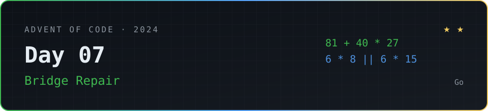
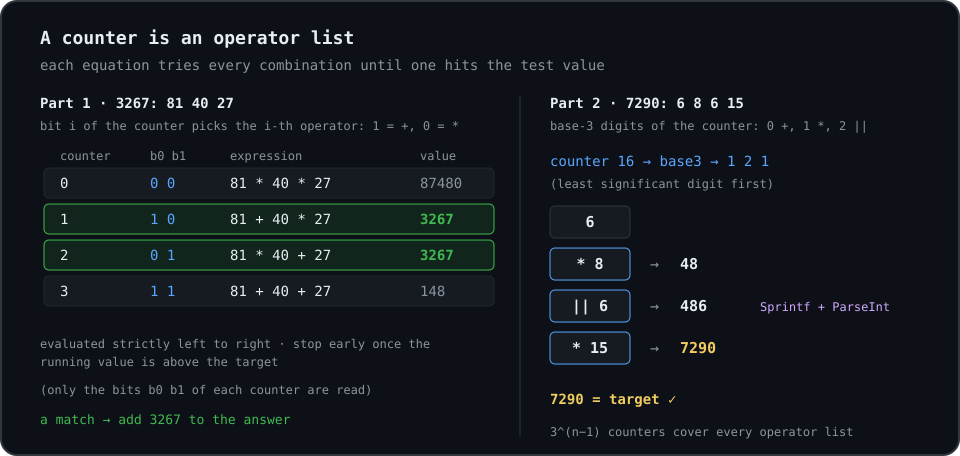

<div align="center">
  
</div>

> [!IMPORTANT]
> **The code was written 100% by a human.** Every line of the solutions in this repository was written by hand, without any kind of help from artificial intelligence: no generated code, no hints, no suggestions.
> AI was only used afterwards, to turn that finished, hand-written code into this README (the text and the diagrams).

## 🧩 The puzzle

Each line is an equation with its operators missing, like `3267: 81 40 27`. Operators are always
evaluated **left to right** (no precedence), and the numbers keep their order.

| Part | Question |
| :--: | -------- |
| ⭐ 1 | Using `+` and `*`, which equations can be made true? Add up their test values. |
| ⭐ 2 | Same, but a third operator `\|\|` glues two numbers together (`12 \|\| 345` is `12345`). |

## 💡 The idea

An equation with `n` numbers has `n − 1` operator slots. Both parts loop **a counter from 0 to `3^(n−1) − 1`**
and read each counter as a list of operators:

- **Part 1** reads the counter in binary: bit `i` set means `+` in slot `i`, otherwise `*`.
- **Part 2** reads the counter in base 3: digit `0` is `+`, `1` is `*`, `2` is `||`.

For each counter, evaluate left to right and stop early as soon as the running value is above the
target (none of the operators can make a positive value smaller). The first list that hits the target
makes the equation valid.

<div align="center">
  
</div>

## 🛠️ Implementations

| Language | Highlights |
| -------- | ---------- |
| [Go](./go) | `parseLine` reads the target as `int64` and the numbers with a regex. Part 1 (`checkAnyCombinationMatchesTheNumber`) tests bits with `isBitSet`. Part 2 (`checkAnyCombinationMatchesTheNumberBase3`) gets the digits from `base3(n, size)` and does the concatenation by formatting both numbers with `fmt.Sprintf("%d%d", ...)` and parsing the result back. |

```go
switch operators[i-1] {
case 0:
	sum += int64(operand)
case 1:
	sum *= int64(operand)
case 2:
	n, _ := strconv.ParseInt(fmt.Sprintf("%d%d", sum, operand), 10, 64)

	sum = n
}
```

## ⏱️ Complexity

For an equation with `n` numbers:

| | Time | Memory |
| - | :--: | :----: |
| Part 1 | `O(3^(n−1) · n)` | `O(n)` |
| Part 2 | `O(3^(n−1) · n)` | `O(n)` |

## ▶️ Running

The program reads `../input.txt`, so the input file lives in the day folder.

```bash
cd go && go run .    # Go
```
