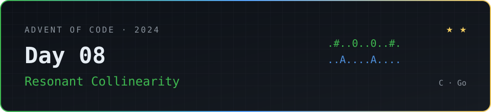
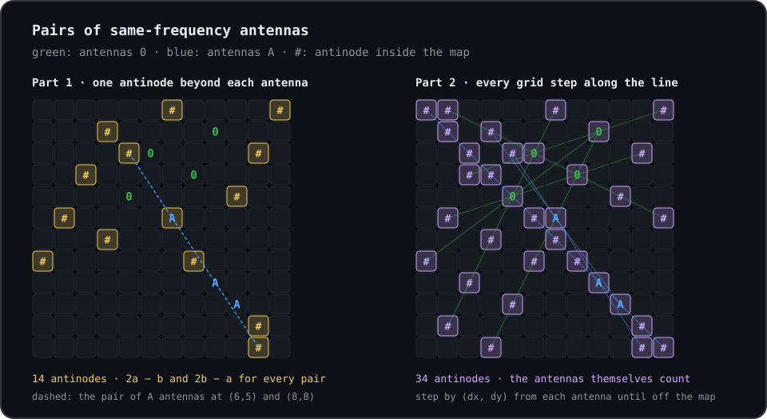

<div align="center">
  
</div>

> [!IMPORTANT]
> **The code was written 100% by a human.** Every line of the solutions in this repository was written by hand, without any kind of help from artificial intelligence: no generated code, no hints, no suggestions.
> AI was only used afterwards, to turn that finished, hand-written code into this README (the text and the diagrams).

## 🧩 The puzzle

The map shows antennas, each marked with a frequency (a digit or a letter). Two antennas with the same
frequency create **antinodes**: points on the line through them.

| Part | Question |
| :--: | -------- |
| ⭐ 1 | An antinode sits on the line at the point where one antenna is twice as far as the other, so each pair makes two of them. How many distinct cells inside the map hold an antinode? |
| ⭐ 2 | Now every grid cell in line with a pair, at any multiple of their offset (the antennas included), is an antinode. How many distinct cells is that? |

## 💡 The idea

Group the antennas by frequency and look at every pair `a`, `b` of the same group.

- **Part 1**: the two antinodes are `2a − b` (beyond `a`) and `2b − a` (beyond `b`). Keep the ones that
  fall inside the map.
- **Part 2**: with the offset `d = b − a`, start at an antenna and keep stepping by `d` (and by `−d`)
  until leaving the map, recording every cell on the way.

A set removes the duplicates, since different pairs often hit the same cell.

<div align="center">
  
</div>

## 🛠️ Implementations

| Language | Highlights |
| -------- | ---------- |
| [C](./c) | Reads the file with `fgetc`. Antennas are stored in 62 linked lists, one per frequency (`0-9`, `a-z`, `A-Z` mapped by `get_index`). The set of antinodes is a fixed array of `Vector2` with a linear duplicate check in `add_to_set`. Part 2 walks every ordered pair, stepping from `a` away from `b`, so both directions get covered. |
| [Go](./go) | Builds a `map[rune][]Vector2` of antennas and a `map[Vector2]struct{}` of antinodes. Part 2 walks from `a` in both directions at once inside one loop, until both walkers are out of bounds. The part 1 test uses the public example. |

```go
ant1 := Vector2{x: 2*a.x - b.x, y: 2*a.y - b.y}
ant2 := Vector2{x: 2*b.x - a.x, y: 2*b.y - a.y}
```

## ⏱️ Complexity

With `k` antennas per frequency on a `w × h` map and `s` antinodes found:

| | Time | Memory |
| - | :--: | :----: |
| Part 1 (Go) | `O(k²)` pairs | `O(s)` |
| Part 2 (Go) | `O(k² · max(w, h))` | `O(s)` |
| C | the same, times `O(s)` per insertion for the linear set | `O(w · h)` |

## ▶️ Running

Both versions read `../input.txt`, so the input file lives in the day folder.

```bash
cd c  && make && ./aoc    # C (make clean to remove the build)
cd go && go run .         # Go
```
