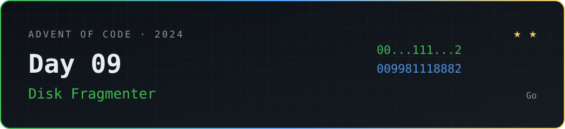
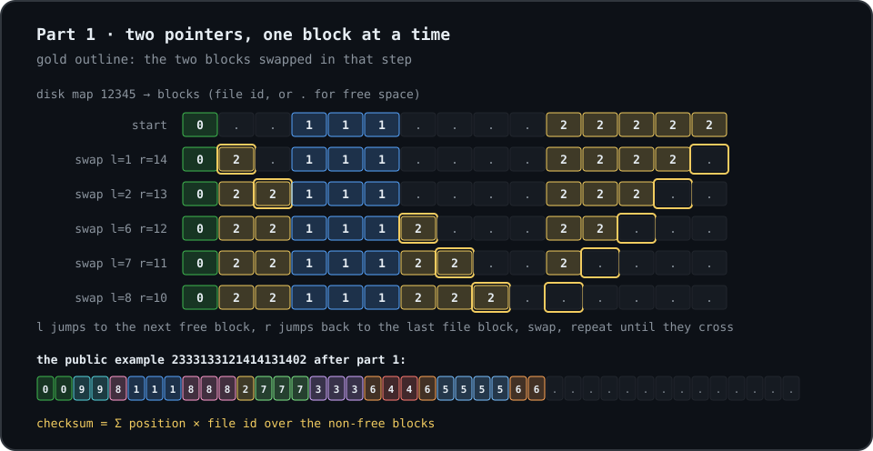
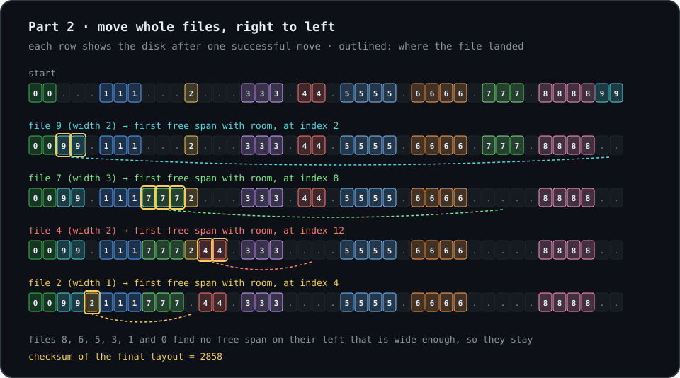

<div align="center">
  
</div>

> [!IMPORTANT]
> **The code was written 100% by a human.** Every line of the solutions in this repository was written by hand, without any kind of help from artificial intelligence: no generated code, no hints, no suggestions.
> AI was only used afterwards, to turn that finished, hand-written code into this README (the text and the diagrams).

## 🧩 The puzzle

The input is a single line of digits, a **disk map**. The digits alternate between the length of a file
and the length of the free space after it, and each file gets an ID in order (0, 1, 2, ...). So `12345`
means one block of file 0, two free blocks, three blocks of file 1, four free blocks, five blocks of
file 2: `0..111....22222`.

The **checksum** of a disk is the sum of `position × file ID` over all the file blocks.

| Part | Question |
| :--: | -------- |
| ⭐ 1 | Move file blocks **one at a time** from the end of the disk into the leftmost free block, until there are no gaps. What is the checksum? |
| ⭐ 2 | Instead, move **whole files**, trying each file once from the highest ID down, into the leftmost span of free blocks that fits it (only to the left). What is the checksum? |

## 💡 The idea

Both parts first expand the disk map into one entry per block: the file ID, or `-1` for free space.

### Part 1 · two pointers

A left pointer looks for the next free block, a right pointer looks for the last file block, and the two
are swapped. When the pointers cross, the disk is compact.

<div align="center">
  
</div>

### Part 2 · whole files

Walk the files from the right end of the disk to the left. For each file, measure its width, then scan
from the start of the disk for the first run of free blocks that is at least as wide and starts before
the file. If one is found, swap the file's blocks with the start of that run.

<div align="center">
  
</div>

## 🛠️ Implementations

| Language | Highlights |
| -------- | ---------- |
| [Go](./go) | `parseIds` expands the map into a `[]Id` (an `int64` type with `isFreeSpace()` for `-1`). `rearrangeFragmentedIds` is the two-pointer loop, `rearrangeIdBlocks` finds file spans from the right and free spans from the left and moves them with a block `swap`, and `checksumIds` skips free blocks. A generic `unwrap` helper turns errors into an exit. Both tests use the public example. |
| [Python helper](./go/main.py) | Not a solution: a small visualizer kept in the Go folder. It takes the expanded public example (`00...111...2...333.44.5555.6666.777.888899`), replays a hard-coded list of 12 swaps (the part 1 swaps for that example), and prints the disk after each one with ANSI colours marking the two swapped positions. |

```go
for l < r {
	for !dids[l].isFreeSpace() {
		l++
	}

	for dids[r].isFreeSpace() {
		r--
	}

	if l >= r {
		break
	}

	dids[l], dids[r] = dids[r], dids[l]
}
```

## ⏱️ Complexity

With `n` blocks on the expanded disk:

| | Time | Memory |
| - | :--: | :----: |
| Part 1 | `O(n)` | `O(n)` |
| Part 2 | `O(n²)` in the worst case: a scan from the start of the disk for every file | `O(n)` |

## ▶️ Running

The Go program reads `../input.txt`, so the input file lives in the day folder.

```bash
cd go && go run .           # Go
cd go && go test            # example tests
cd go && python3 main.py    # the swap visualizer for the example (needs no input)
```
