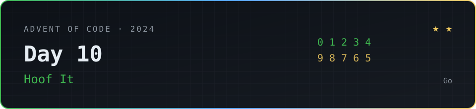
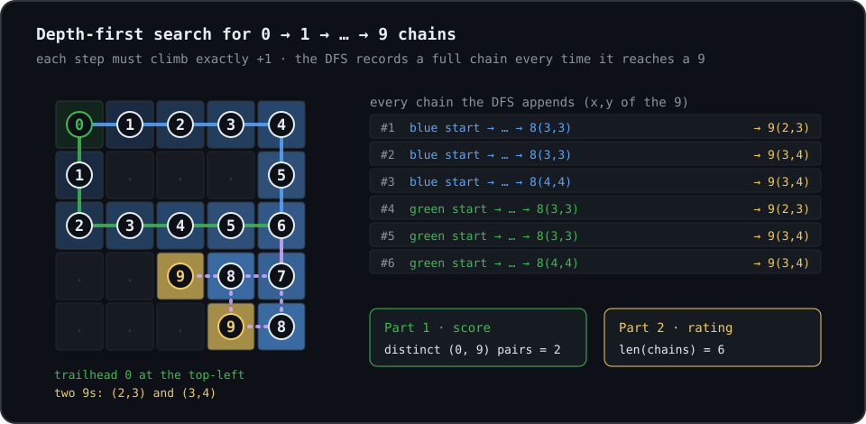

<div align="center">
  
</div>

> [!IMPORTANT]
> **The code was written 100% by a human.** Every line of the solutions in this repository was written by hand, without any kind of help from artificial intelligence: no generated code, no hints, no suggestions.
> AI was only used afterwards, to turn that finished, hand-written code into this README (the text and the diagrams).

## 🧩 The puzzle

The input is a topographic map: a grid of digits from `0` (lowest) to `9` (highest).
A *hiking trail* starts on a `0`, ends on a `9`, and every step goes up, down, left or right to a cell exactly one higher.

| Part | Question |
| :--: | -------- |
| ⭐ 1 | For each trailhead (`0`), how many different `9`s can it reach? Add up these *scores*. |
| ⭐ 2 | For each trailhead, how many different trails start there? Add up these *ratings*. |

## 💡 The idea

Both parts come from **one depth-first search**. From every `0` the code recursively walks to neighbours whose height is the next expected value. Each time it reaches a `9`, it saves the complete chain of 10 positions.

- **Part 2** is just the number of chains found, because every chain is a distinct trail.
- **Part 1** keeps only the first and last cell of each chain (trailhead and summit) and counts the distinct pairs.

The small made-up map below has one trailhead. Two routes reach the 6 and then the trail forks three ways over two different 9s, so the score is `2` and the rating is `6`.

<div align="center">
  
</div>

## 🛠️ Implementations

| Language | Highlights |
| -------- | ---------- |
| [Go](./go) | `getChains` receives the chain as a fixed-size array `[10]Vec2` **by value**, so each recursive branch works on its own copy and no backtracking is needed. Part 1 builds a `"x-y-x-y"` string key from the head and tail of each chain and counts the keys in a map. Both parts parse the grid and run the search again from scratch. |

```go
func (in *Input) getChains(chain [CHAIN_SIZE]Vec2, x, y, next int) {
  if in.grid[y][x] != next {
    return
  }

  chain[next] = Vec2{ x: x, y: y }

  if in.grid[y][x] == 9 {
    in.chains = append(in.chains, chain)

    return
  }
  // ... recurse into the 4 neighbours with next+1
```

## ⏱️ Complexity

With `n` cells and `T` trails in total:

| | Time | Memory |
| - | :--: | :----: |
| Search (both parts) | `O(n + P)`, where `P` is the number of partial trails explored | `O(T)` stored chains |
| Part 1 dedup | `O(T)` | `O(T)` map entries |

## ▶️ Running

The Go version opens `../input.txt`, so put the input in the day folder.

```bash
cd go && go run .
```
