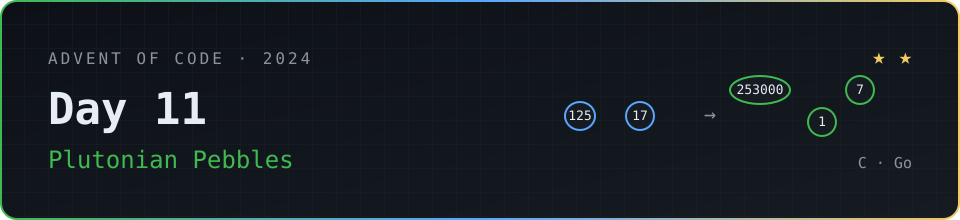
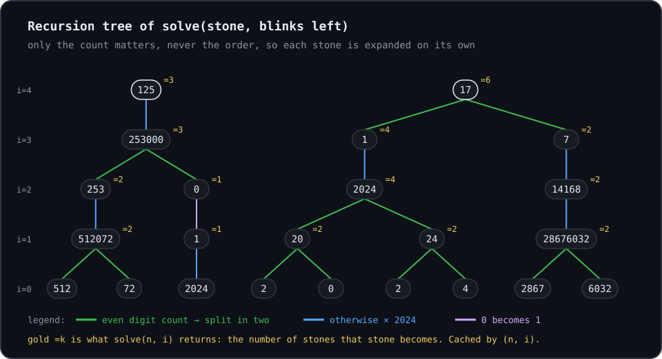

<div align="center">
  
</div>

> [!IMPORTANT]
> **The code was written 100% by a human.** Every line of the solutions in this repository was written by hand, without any kind of help from artificial intelligence: no generated code, no hints, no suggestions.
> AI was only used afterwards, to turn that finished, hand-written code into this README (the text and the diagrams).

## 🧩 The puzzle

A line of stones is engraved with numbers. Every time you *blink*, each stone changes at the same time, following the first rule that applies:

1. A `0` becomes a `1`.
2. A number with an even number of digits splits into two stones: the left half and the right half of its digits (leading zeros dropped).
3. Any other number is multiplied by `2024`.

| Part | Question |
| :--: | -------- |
| ⭐ 1 | How many stones are there after blinking 25 times? |
| ⭐ 2 | How many stones are there after blinking 75 times? |

## 💡 The idea

The line grows exponentially, so building it is hopeless for 75 blinks. But the question only asks for a **count**, and the order of the stones never matters: every stone evolves on its own.

So the code defines `solve(n, i)` = "how many stones does the single stone `n` become after `i` more blinks":

- `i == 0` → `1`
- otherwise apply the rule and add up the results for the new stone(s) with `i - 1`.

The same `(n, i)` pairs come back again and again (small numbers like `0`, `1`, `2`, `4`, `2024` show up everywhere), so each result is **memoised** by the key `(n, i)`. The answer is the sum of `solve(stone, 25)` or `solve(stone, 75)` over the starting stones.

<div align="center">
  
</div>

With the example `125 17` the tree above gives `3 + 6 = 9` stones after 4 blinks.

## 🛠️ Implementations

| Language | Highlights |
| -------- | ---------- |
| [C](./c) | Recursive `solve` with a hand-written hash map (`map.c`: 1000 buckets with chaining, a djb2-style hash of `(n, i)`). Digits are split by printing the number with `snprintf` and parsing both halves with `strtoll`. One map is shared by part 1 and part 2, so the 75-blink run reuses everything cached during the 25-blink run. The starting stones are written directly in `main.c`. |
| [Go](./go) | Same recursion in `calcLength`, memoised in a `map[Key]int64` where `Key` is `{number, steps}`. Halves come from `strconv.FormatInt` and string slicing. Each part builds its own `Result` with a fresh cache. |

```go
if number == 0 {
  result = rs.calcLength(1, steps-1)
} else if len(strconv.FormatInt(number, 10))%2 == 0 {
  // split into left and right halves
  result += rs.calcLength(l, steps-1)
  result += rs.calcLength(r, steps-1)
} else {
  result = rs.calcLength(number*2024, steps-1)
}

rs.cache[key] = result
```

## ⏱️ Complexity

With `D` = number of distinct stone values that ever appear (only a few thousand in practice) and `B` blinks:

| | Time | Memory |
| - | :--: | :----: |
| Part 1 | `O(D · B)` cached calls | `O(D · B)` |
| Part 2 | `O(D · B)` cached calls | `O(D · B)` |

## ▶️ Running

```bash
cd c  && make && ./aoc    # C: the stones are inside main.c
cd go && go run .         # Go: reads ../../input.txt (two folders above go/)
```
