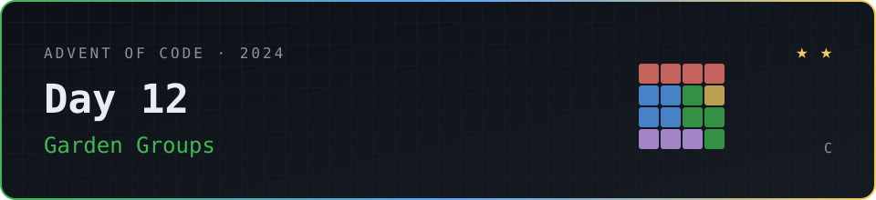
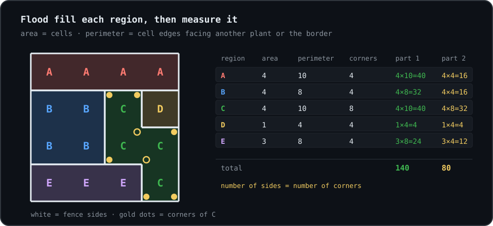
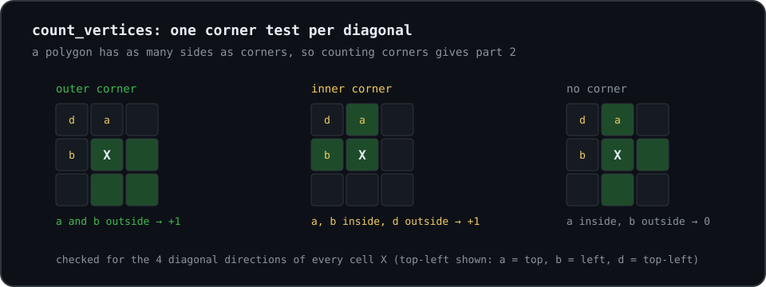

<div align="center">
  
</div>

> [!IMPORTANT]
> **The code was written 100% by a human.** Every line of the solutions in this repository was written by hand, without any kind of help from artificial intelligence: no generated code, no hints, no suggestions.
> AI was only used afterwards, to turn that finished, hand-written code into this README (the text and the diagrams).

## 🧩 The puzzle

A garden map is a grid of letters, one plant type per plot. Plots with the same letter that touch horizontally or vertically form a **region**, and every region needs a fence.

| Part | Question |
| :--: | -------- |
| ⭐ 1 | The price of a region is `area × perimeter`. What is the total price of all regions? |
| ⭐ 2 | With a bulk discount, the price is `area × number of sides` (a straight fence counts once, whatever its length). What is the new total? |

## 💡 The idea

The program walks over every cell. When it finds one that is not visited yet, it **flood-fills** the region with a recursive DFS, collecting its cells into a linked list. Then it measures that list:

- **Area**: the number of cells.
- **Perimeter**: for each cell, count the 4 neighbours that are outside the grid or hold a different letter.
- **Sides**: counting sides directly is awkward, but a closed polygon has exactly as many **sides as corners**. So the code counts corners instead.

<div align="center">
  
</div>

To count corners, every cell looks at its four diagonals. For each diagonal (say top-left) it checks the two orthogonal neighbours on that side (top and left) and the diagonal cell itself:

<div align="center">
  
</div>

Both parts come out of the same loop, so one pass over the map prints both answers.

## 🛠️ Implementations

| Language | Highlights |
| -------- | ---------- |
| [C](./c) | `get_area` is the recursive flood fill; it marks cells as visited in a small hash map (`map.c`) keyed by `(x, y)` and appends each cell to a linked list (`ll.c`). `get_perimeter` and `count_vertices` then walk that list. The grid size is found by measuring the first line. |

```c
if (is_edge(grid, chr, p1) && is_edge(grid, chr, p2)) {
    vertices++;                       // outer corner
} else if (!is_edge(grid, chr, p1) && !is_edge(grid, chr, p2) && is_edge(grid, chr, p3)) {
    vertices++;                       // inner corner
}
```

## ⏱️ Complexity

For a grid with `n` cells:

| | Time | Memory |
| - | :--: | :----: |
| Part 1 | `O(n)` (each cell is filled once and checks 4 neighbours) | `O(n)` |
| Part 2 | `O(n)` (each cell checks 4 diagonals) | `O(n)` |

## ▶️ Running

The program takes the input path as its only argument.

```bash
cd c && make && ./aoc ../input.txt
```
