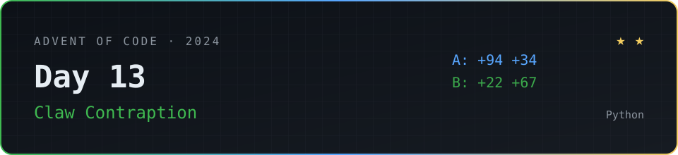
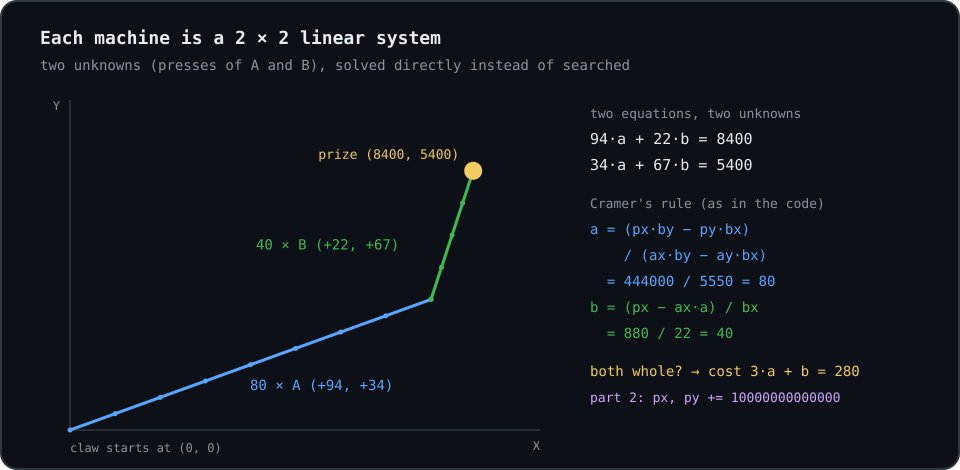

<div align="center">
  
</div>

> [!IMPORTANT]
> **The code was written 100% by a human.** Every line of the solutions in this repository was written by hand, without any kind of help from artificial intelligence: no generated code, no hints, no suggestions.
> AI was only used afterwards, to turn that finished, hand-written code into this README (the text and the diagrams).

## 🧩 The puzzle

Each claw machine has two buttons. Button **A** costs 3 tokens and moves the claw by a fixed `(X, Y)`; button **B** costs 1 token and moves it by another fixed `(X, Y)`. A prize sits at some position, and you win it if the claw lands exactly on it.

| Part | Question |
| :--: | -------- |
| ⭐ 1 | What is the fewest number of tokens needed to win every prize that can be won? |
| ⭐ 2 | Same question, but every prize coordinate is `10000000000000` larger. |

## 💡 The idea

Pressing A `a` times and B `b` times gives two linear equations:

```
ax·a + bx·b = px
ay·a + by·b = py
```

Two equations with two unknowns, so the code does not search or minimise anything: it solves the system directly with **Cramer's rule**, and accepts the result only when both `a` and `b` are whole numbers. The cost is `3·a + b`.

<div align="center">
  
</div>

Since the formula costs the same no matter how big the numbers are, part 2 just shifts the prize and runs the same function.

## 🛠️ Implementations

| Language | Highlights |
| -------- | ---------- |
| [Python](./python) | `get_data` parses the three lines of each machine (splitting on `+` for buttons and `=` for the prize). `solve_claw_machine` computes `a` with Cramer's rule, derives `b` from the first equation, and checks `% 1 == 0` on both float results; otherwise it returns `None`. `increaseAxisBy` adds the part 2 offset to the machine in place, after part 1 was already computed for it. |

```python
def solve_claw_machine(m: ClawMachine):
    ca = (m.px * m.by - m.py * m.bx) / (m.ax * m.by - m.ay * m.bx)
    cb = (m.px - m.ax * ca) / m.bx

    if ca % 1 == 0 and cb % 1 == 0:
        return int(ca * 3 + cb)
```

## ⏱️ Complexity

For `m` machines:

| | Time | Memory |
| - | :--: | :----: |
| Part 1 | `O(m)`, constant work per machine | `O(m)` parsed machines |
| Part 2 | `O(m)` | `O(m)` |

## ▶️ Running

The script opens `../input.txt`, so put the input in the day folder.

```bash
cd python && python3 main.py
```
