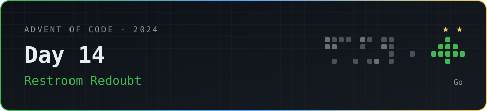
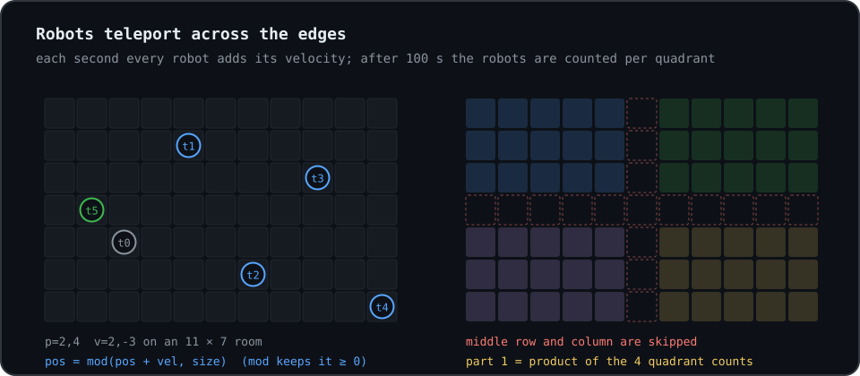
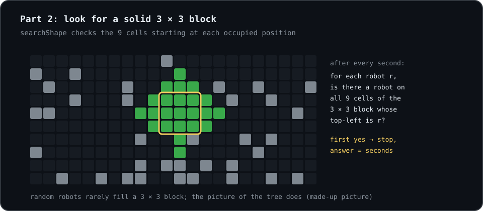

<div align="center">
  
</div>

> [!IMPORTANT]
> **The code was written 100% by a human.** Every line of the solutions in this repository was written by hand, without any kind of help from artificial intelligence: no generated code, no hints, no suggestions.
> AI was only used afterwards, to turn that finished, hand-written code into this README (the text and the diagrams).

## 🧩 The puzzle

Security robots patrol a rectangular room. Each one has a position `p=x,y` and a constant velocity `v=dx,dy` in tiles per second. When a robot walks off an edge it reappears on the opposite side.

| Part | Question |
| :--: | -------- |
| ⭐ 1 | After 100 seconds, count the robots in each of the four quadrants (robots exactly on the middle row or column don't count). What is the product of the four counts? |
| ⭐ 2 | At some moment most robots arrange themselves into a picture of a Christmas tree. What is the fewest number of seconds until that happens? |

## 💡 The idea

**Part 1** is a plain simulation. Moving a robot is `pos = mod(pos + vel, size)`, with a `mod` that always returns a non-negative number. After 100 steps each robot is assigned to a quadrant by comparing it with the middle row and column.

<div align="center">
  
</div>

**Part 2** has no formula, so the code needs a sign that the picture appeared. Robots in random positions almost never fill a solid block, but a drawing does. So after every second it checks whether any robot is the top-left corner of a **3 × 3 block completely covered by robots** (and away from the walls). The first second where this happens is the answer.

<div align="center">
  
</div>

## 🛠️ Implementations

| Language | Highlights |
| -------- | ---------- |
| [Go](./go) | The room size is taken as the largest `x + 1` and `y + 1` seen among the robots. Part 1 moves each robot 100 times in its own goroutine (`sync.WaitGroup`), groups robots by position and multiplies the quadrant counts. Part 2 keeps a `map[Vec2]struct{}` of occupied tiles every second and calls `searchShape` from every occupied tile. |

```go
func (r *Robot) move(w, h int) {
	r.pos.x = mod(r.pos.x+r.vel.x, w)
	r.pos.y = mod(r.pos.y+r.vel.y, h)
}
```

## ⏱️ Complexity

With `r` robots, a room of `w × h` tiles and `t` seconds until the picture:

| | Time | Memory |
| - | :--: | :----: |
| Part 1 | `O(100 · r + w · h)` | `O(r)` |
| Part 2 | `O(t · r)` (9 lookups per robot each second) | `O(r)` |

## ▶️ Running

The Go version opens `../input.txt`, so put the input in the day folder.

```bash
cd go && go run .
```
