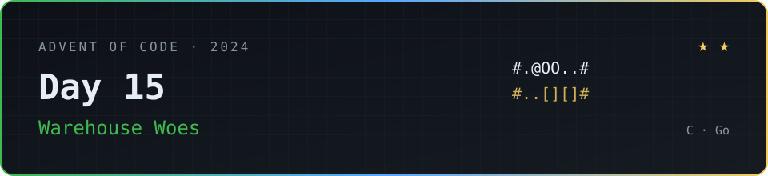
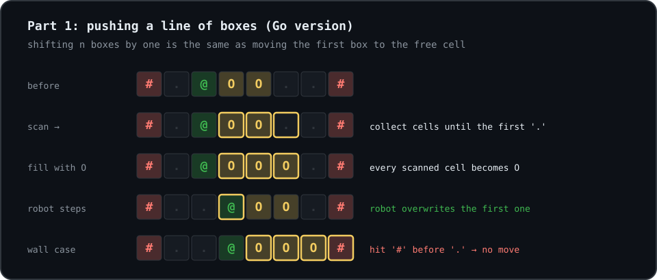
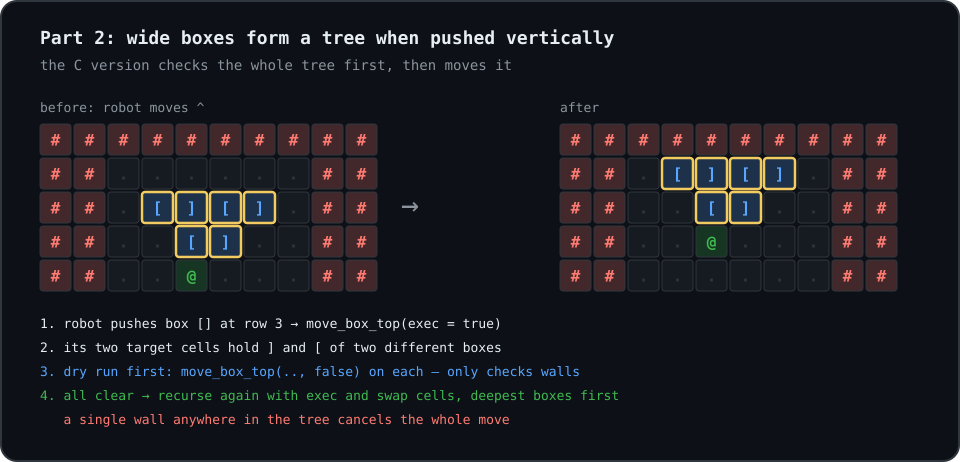

<div align="center">
  
</div>

> [!IMPORTANT]
> **The code was written 100% by a human.** Every line of the solutions in this repository was written by hand, without any kind of help from artificial intelligence: no generated code, no hints, no suggestions.
> AI was only used afterwards, to turn that finished, hand-written code into this README (the text and the diagrams).

## 🧩 The puzzle

A robot (`@`) moves around a warehouse full of boxes (`O`) and walls (`#`), following a long list of moves (`^ > v <`). When it walks into boxes it pushes the whole line of them, unless a wall is in the way, in which case nothing moves.
At the end, each box has a *GPS coordinate* `100 × row + column`.

| Part | Question |
| :--: | -------- |
| ⭐ 1 | What is the sum of the GPS coordinates of all boxes after the robot finishes? |
| ⭐ 2 | The warehouse is twice as wide: every tile becomes two (`#` → `##`, `O` → `[]`, `@` → `@.`). Boxes are now two cells wide and can push two boxes at once. What is the new sum (measured from the left half `[` of each box)? |

## 💡 The idea

### Part 1: a line of boxes

Moving in one direction, the robot either hits a wall (nothing happens) or a line of boxes followed by a free cell. Shifting every box by one gives the same picture as **moving the first box to that free cell**. The Go version uses exactly this: it collects the cells until the first `.`, writes `O` into all of them, and then the robot overwrites the first one.

<div align="center">
  
</div>

The C version gets the same result recursively: `move_right(pos)` first asks the next cell to move, and only if that succeeds swaps the two cells.

### Part 2: wide boxes

Left and right pushes still form a single line, so the C code reuses the same one-cell recursion for `[` and `]`. Up and down pushes are different: one box can rest on **two** boxes, so the push spreads out like a tree. `move_box_top` / `move_box_bottom` first make a **dry run** (`exec = false`) to see if any box in the tree would hit a wall, and only when all of them are free do they recurse again and swap the cells, deepest boxes first.

<div align="center">
  
</div>

## 🛠️ Implementations

| Language | Highlights |
| -------- | ---------- |
| [C](./c) | `one.c` and `two.c` are separate programs, both built with **raylib**. The board is a flat array of `Block`s and moves are recursive swaps. Both have an optional animation mode (`WITH_ANIMATION`) that draws the warehouse while the robot moves and then highlights the boxes as their GPS coordinates are added; by default they just print the answer. Solves **both parts**. |
| [Go](./go) | Solves **part 1 only**; part 2 is not solved yet in Go. `Move` uses the "fill the line with `O`" trick shown above. |

```go
for {
	if w.isAWall(to) {
		isPossibleToMove = false
		break
	}

	motions = append(motions, to)

	if w.isBlank(to) {
		break
	}

	to = to.Sum(dir)
}
```

## ⏱️ Complexity

With `m` moves, a longest pushed line or tree of `k` cells, and `n` cells in the map:

| | Time | Memory |
| - | :--: | :----: |
| Part 1 | `O(m · k + n)` | `O(n)` |
| Part 2 | `O(m · k + n)` (the C dry run and the real run each visit the tree) | `O(n)` |

## ▶️ Running

The C programs read the map from `input-01.txt` and the moves from `input-02.txt` in the `c` folder, and the Makefile expects raylib in the repository's `clibs` folder.
The Go version reads `../test.txt` by default and `../input.txt` with `-final`.

```bash
cd c  && make && ./one && ./two   # C (both parts)
cd go && go run . -final          # Go (part 1)
```
