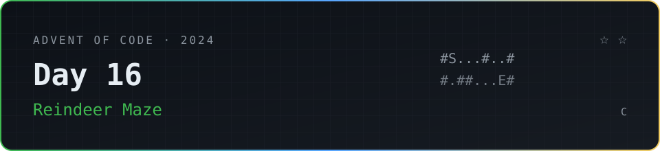
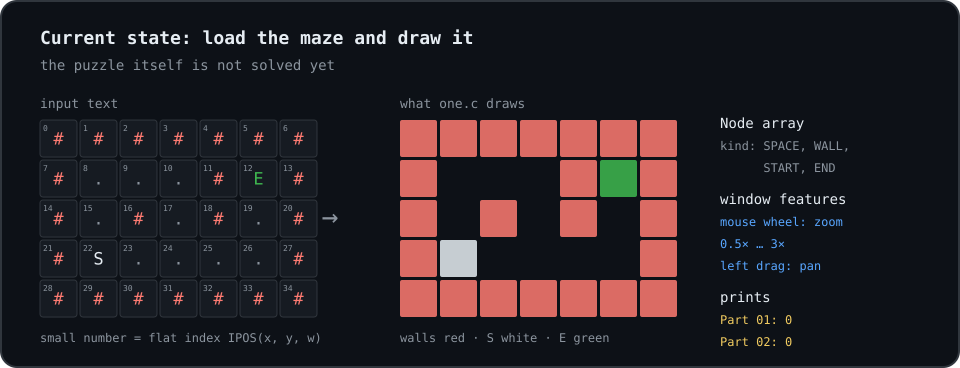

<div align="center">
  
</div>

> [!IMPORTANT]
> **The code was written 100% by a human.** Every line of the solutions in this repository was written by hand, without any kind of help from artificial intelligence: no generated code, no hints, no suggestions.
> AI was only used afterwards, to turn that finished, hand-written code into this README (the text and the diagrams).

## 🧩 The puzzle

A reindeer starts on the `S` tile of a maze, facing east, and wants to reach the `E` tile. Moving forward one tile costs 1 point and turning 90° clockwise or counter-clockwise costs 1000 points.

| Part | Question |
| :--: | -------- |
| 1 | What is the lowest score a reindeer could possibly get? *(not solved in this repository)* |
| 2 | How many tiles are part of at least one of the best (lowest-score) paths? *(not solved in this repository)* |

> [!IMPORTANT]
> This day is **not solved yet** in the repository. The code loads the maze and shows it in a window, but nothing computes the answers yet, so both programs print `0`.

## 💡 What the code does so far

`one.c` reads `./input.txt`, measures the grid (`get_grid_size` counts the longest line and the number of newlines) and turns every character into a `Node` in one flat array. Positions are converted with two macros: `IPOS(x, y, w)` gives the index of a cell and `VPOS(i, w)` gives the cell of an index. The start and end positions are remembered on the board.

With `WITH_ANIMATION` enabled (the default), it opens a **raylib** window that draws the maze in 5-pixel squares and lets you zoom with the mouse wheel and pan by dragging with the left button.

<div align="center">
  
</div>

`two.c` only prints `Part 02: 0` for now.

## 🛠️ Implementations

| Language | Highlights |
| -------- | ---------- |
| [C](./c) | Maze loading and a zoomable / draggable raylib viewer (`one.c`), helpers to read a whole file (`io.c`) and to size the grid (`aoc.c`, with the `ITER_OVER` / `ITER_END` loop macros). No solution yet for either part. |

```c
#define IPOS(x, y, w) (x) + (y) * (w)
#define VPOS(i, w) (VectorI2){ .x = (i) % (w), .y = (i) / (w) }
```

## ⏱️ Complexity

| | Time | Memory |
| - | :--: | :----: |
| Loading the maze | `O(n)` for `n` characters | `O(n)` |

## ▶️ Running

`one` reads `input.txt` from the `c` folder. The Makefile links raylib from the repository's `clibs` folder.

```bash
cd c && make && ./one   # opens the maze viewer
./two
```
