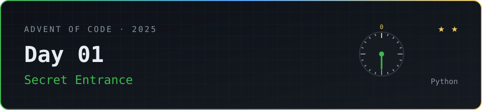
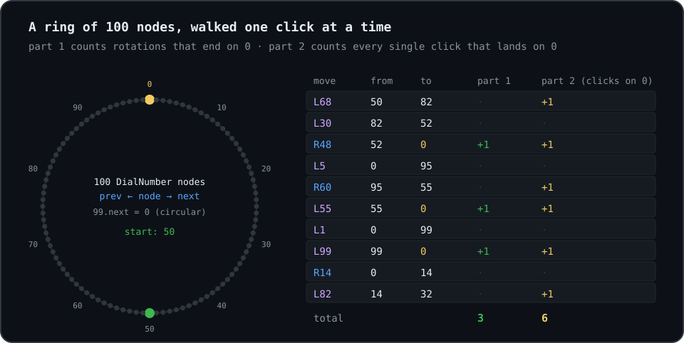

<div align="center">
  
</div>

> [!IMPORTANT]
> **The code was written 100% by a human.** Every line of the solutions in this repository was written by hand, without any kind of help from artificial intelligence: no generated code, no hints, no suggestions.
> AI was only used afterwards, to turn that finished, hand-written code into this README (the text and the diagrams).

## 🧩 The puzzle

A safe has a dial numbered `0` to `99` that starts pointing at `50`. The input is a list of rotations such as `L68` (68 clicks to the left, towards lower numbers) or `R48` (48 clicks to the right). The dial wraps around: one click left from `0` is `99`, one click right from `99` is `0`.

| Part | Question |
| :--: | -------- |
| ⭐ 1 | How many rotations leave the dial pointing at `0`? |
| ⭐ 2 | How many times does the dial point at `0` during the whole process, counting every single click (including the ones in the middle of a rotation)? |

## 💡 The idea

The code models the dial literally: a **circular doubly linked list** of 100 nodes, where `next` turns right and `prev` turns left. A rotation of `n` clicks follows `n` pointers, one at a time.

- **Part 1** checks the value after each full rotation.
- **Part 2** uses the count of zero hits that `left(n)` / `right(n)` return, since they check the value after every single click.

<div align="center">
  
</div>

With the example from the puzzle, the dial stops on `0` three times, and touches `0` six times in total.

## 🛠️ Implementations

| Language | Highlights |
| -------- | ---------- |
| [Python](./python) | `Dial` builds the ring of `DialNumber` nodes and moves to the starting value with `right(50)`, saving that node so `restore()` can go back to it before part 2. `DialCommandParser` reads the lines and runs `execute()` (part 1) and `executeV2()` (part 2); any line that does not start with `L` or `R` raises an exception. |

```python
def right(self, n=1):
    zeroHits = 0

    for i in range(n):
        self.current = self.current.next

        if self.current.value == 0:
            zeroHits += 1

    return zeroHits
```

## ⏱️ Complexity

With `S` = total number of clicks in the input (the sum of all rotation sizes):

| | Time | Memory |
| - | :--: | :----: |
| Part 1 | `O(S)` | `O(100)` nodes |
| Part 2 | `O(S)` | `O(100)` nodes |

## ▶️ Running

The script reads `./input.txt` from the current directory.

```bash
cd python && python3 main.py
```
