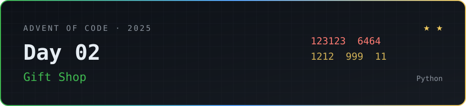
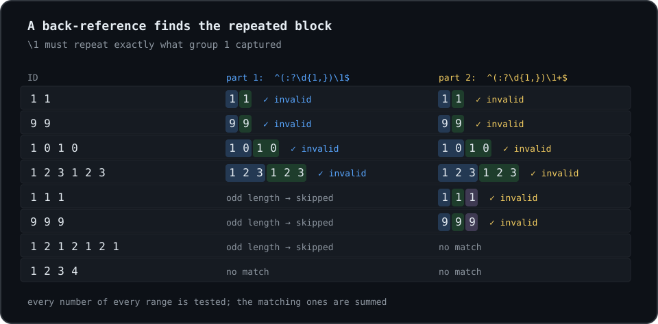

<div align="center">
  
</div>

> [!IMPORTANT]
> **The code was written 100% by a human.** Every line of the solutions in this repository was written by hand, without any kind of help from artificial intelligence: no generated code, no hints, no suggestions.
> AI was only used afterwards, to turn that finished, hand-written code into this README (the text and the diagrams).

## 🧩 The puzzle

The input is one line of product ID ranges separated by commas, like `11-22,95-115,998-1012`. Some IDs in those ranges are *invalid* because they are just a sequence of digits repeated.

| Part | Question |
| :--: | -------- |
| ⭐ 1 | An ID is invalid if it is some digit sequence repeated **exactly twice** (`55`, `6464`, `123123`). What is the sum of all invalid IDs in the ranges? |
| ⭐ 2 | Now an ID is invalid if it is some sequence repeated **at least twice** (`111`, `12341234`, `1212121212`). What is the new sum? |

## 💡 The idea

The code checks every single number in every range with a **regular expression that uses a back-reference**. Group 1, `(:?\d{1,})`, captures some leading digits and `\1` demands that exactly the same digits come next:

- Part 1: `^(:?\d{1,})\1$`, the block repeated exactly twice. Numbers with an odd number of digits can never match, so they are skipped before running the regex.
- Part 2: `^(:?\d{1,})\1+$`, the block repeated two or more times.

The regex engine does the work of trying every possible block length.

<div align="center">
  
</div>

For the small ranges `11-22,95-115,998-1012`, part 1 finds `11`, `22`, `99` and `1010`; part 2 also finds `111` and `999`.

## 🛠️ Implementations

| Language | Highlights |
| -------- | ---------- |
| [Python](./python) | Turns each `a-b` into a Python `range(a, b + 1)`, then loops over all numbers twice, once per pattern, collecting the invalid ones and printing their sum. |

```python
pattern = r'^(:?\d{1,})\1$'
pattern2 = r'^(:?\d{1,})\1+$'
```

## ⏱️ Complexity

With `N` = total count of numbers across all ranges and `d` = digits per number:

| | Time | Memory |
| - | :--: | :----: |
| Part 1 | `O(N · d²)` regex checks in the worst case | `O(k)` for the `k` invalid IDs |
| Part 2 | `O(N · d²)` | `O(k)` |

## ▶️ Running

The script reads `./input.txt` from the current directory.

```bash
cd python && python3 main.py
```
