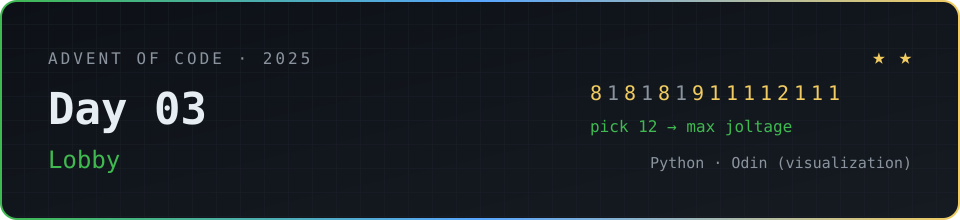
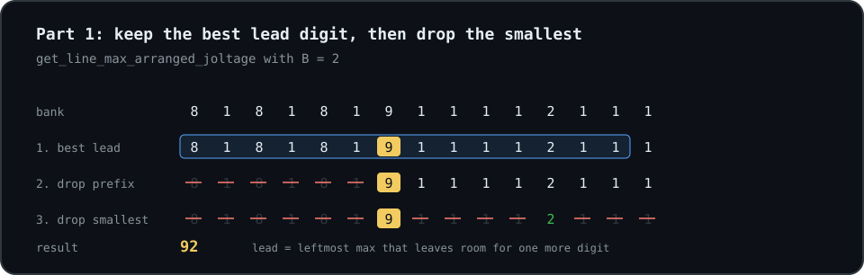
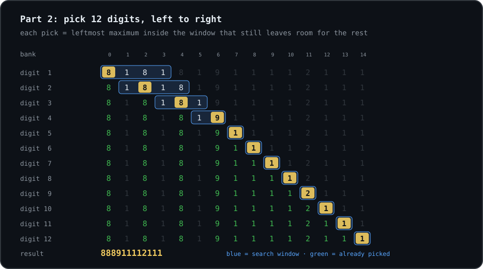

<div align="center">
  
</div>

> [!IMPORTANT]
> **The code was written 100% by a human.** Every line of the solutions in this repository was written by hand, without any kind of help from artificial intelligence: no generated code, no hints, no suggestions.
> AI was only used afterwards, to turn that finished, hand-written code into this README (the text and the diagrams).

## 🧩 The puzzle

Each line of the input is a *bank* of batteries, one digit (1 to 9) per battery. Turning on some batteries produces a *joltage* equal to the number formed by their digits, read in their original order.

| Part | Question |
| :--: | -------- |
| ⭐ 1 | Turning on exactly **2** batteries per bank, what is the sum of the largest possible joltage of every bank? |
| ⭐ 2 | Same, but with exactly **12** batteries per bank. |

## 💡 The idea

To make the biggest number, the first digit matters more than all the others together, so the choice can be made **greedily from left to right**: take the largest digit you can, as early as you can, while still leaving enough digits after it to finish the number.

### Part 1

`get_line_max_arranged_joltage` picks the leftmost largest digit among all positions except the last one, throws away everything before it, and then removes the smallest of the remaining digits (in order of value) until only 2 are left.

<div align="center">
  
</div>

### Part 2

`walking_robots` is the general greedy. For each of the 12 digits it looks at a window that starts right after the previous pick and ends where exactly enough digits remain for the picks still to come, and takes the leftmost maximum of that window.

<div align="center">
  
</div>

With the four example banks from the puzzle the part 1 joltages are `98`, `89`, `78` and `92`.

## 🎬 Visualization

The author made an animation of the part 2 greedy with [`visualization.odin`](./visualization.odin) (Odin + raylib): every bank is a track, the 12 batteries start on the right, and each one in turn is selected, slides over its search window, stops on the best digit and turns green.

https://github.com/user-attachments/assets/d57a323b-7345-4d13-9f5a-5ce50a55a001

## 🛠️ Implementations

| Language | Highlights |
| -------- | ---------- |
| [Python](./main.py) | Reads the banks into lists of ints from the file given on the command line. Part 1 uses the "best lead, then drop the smallest" method (`get_line_max_arranged_joltage`), part 2 the window greedy (`walking_robots` with 12 "robots"). |
| [Odin](./visualization.odin) | Visualization only (it does not print answers). It replays the same window greedy as a list of render operations (`SelectBattery`, `MoveBattery`, `Finish`) and plays them at 5 frames per second after you press <kbd>Enter</kbd>; <kbd>Q</kbd> quits. It reads `./test.txt`. |

```python
while robots_done < B:
    left_most = indexes[-1] + 1 if len(indexes) > 0 else 0
    right_most = size - robots_walking + 1

    max_number_index = left_most

    for i in range(left_most, right_most):
        if line[i] > line[max_number_index]:
            max_number_index = i
```

## ⏱️ Complexity

For a bank of `n` digits and `B` picks:

| | Time | Memory |
| - | :--: | :----: |
| Part 1 | `O(n log n)` per bank (sorting the digits) | `O(n)` |
| Part 2 | `O(B · n)` per bank in the worst case | `O(n)` |

## ▶️ Running

```bash
python3 main.py input.txt                  # both parts
odin run visualization.odin -file          # animation, reads ./test.txt
```
