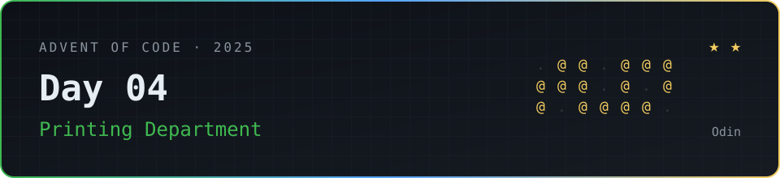
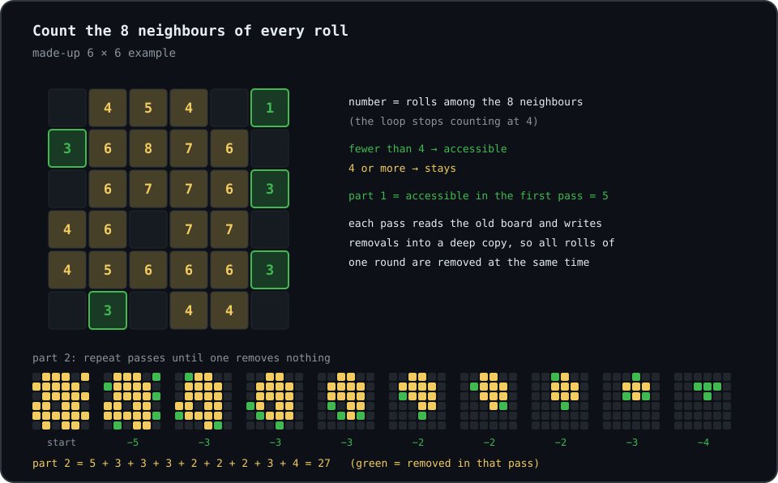

<div align="center">
  
</div>

> [!IMPORTANT]
> **The code was written 100% by a human.** Every line of the solutions in this repository was written by hand, without any kind of help from artificial intelligence: no generated code, no hints, no suggestions.
> AI was only used afterwards, to turn that finished, hand-written code into this README (the text and the diagrams).

## 🧩 The puzzle

The input is a grid where `@` is a roll of paper and `.` is empty floor. A forklift can only reach a roll if **fewer than four** of the eight surrounding cells hold another roll.

| Part | Question |
| :--: | -------- |
| ⭐ 1 | How many rolls can the forklifts reach right now? |
| ⭐ 2 | Removing the reachable rolls may make other rolls reachable. If you keep removing rolls until no more can be reached, how many rolls are removed in total? |

## 💡 The idea

One **pass** looks at every roll, counts the rolls among its 8 neighbours (stopping as soon as the count reaches 4) and marks it as removable if the count is below 4.

The pass reads the current board and writes into a **deep copy**, so every roll in a pass is judged against the same snapshot and all removable rolls disappear at the same time.

- **Part 1** is the count of the first pass.
- **Part 2** keeps running passes on the new board and adding up the counts, until a pass removes nothing.

<div align="center">
  
</div>

## 🛠️ Implementations

| Language | Highlights |
| -------- | ---------- |
| [Odin](./main.odin) | `execute_solution` does one pass and returns both the count and the new board; `main` calls it once for part 1, then again from the original board in a loop for part 2. The board is a `[dynamic][dynamic]ObjectKind` enum whose values are the characters `'@'` and `'.'`. Command line handling lives in [`args.odin`](./args.odin). |
| [Odin visualizer](./visualize.odin) | Run with `--visualize` to open a raylib window. It records the first pass as a list of colour steps (cell being checked, each neighbour hit, roll kept or removed) and plays one step per frame, then shows which cells changed. |

```odin
for p in POSITIONS {
  // ... skip neighbours outside the grid

  if board[cy][cx] == .PaperRoll {
    paper_rolls += 1
  }

  if paper_rolls >= 4 {
    break
  }
}

if paper_rolls < 4 {
  answer += 1
  output[y][x] = .Empty
}
```

## ⏱️ Complexity

For a grid with `n` cells and `p` passes:

| | Time | Memory |
| - | :--: | :----: |
| Part 1 | `O(n)` (8 neighbours per roll) | `O(n)` for the copy |
| Part 2 | `O(p · n)` | `O(n)` per pass for its copy |

## ▶️ Running

The input path is given on the command line.

```bash
odin run . -- input.txt                # prints P1 and P2
odin run . -- input.txt --visualize    # raylib animation of the first pass
```
