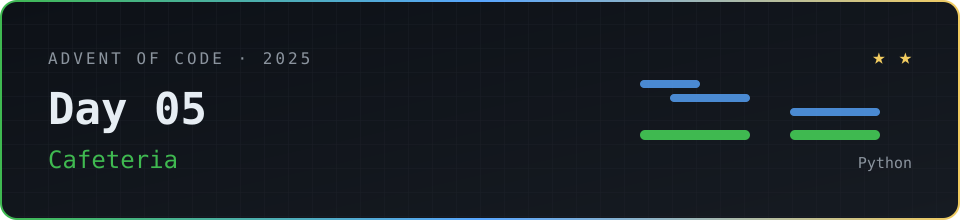
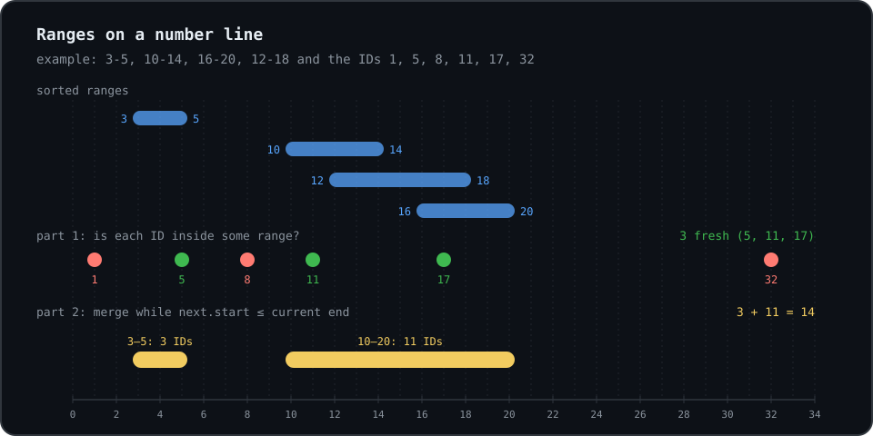
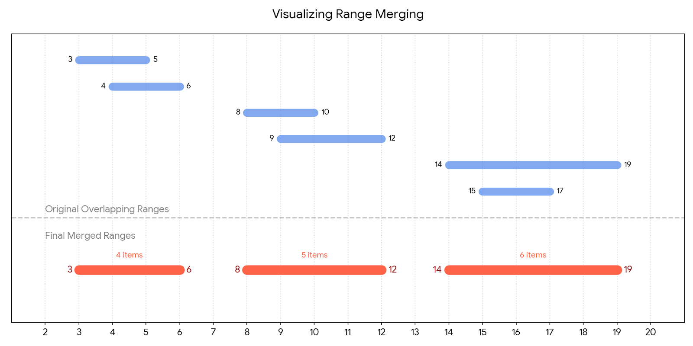

<div align="center">
  
</div>

> [!IMPORTANT]
> **The code was written 100% by a human.** Every line of the solutions in this repository was written by hand, without any kind of help from artificial intelligence: no generated code, no hints, no suggestions.
> AI was only used afterwards, to turn that finished, hand-written code into this README (the text and the diagrams).

## 🧩 The puzzle

The kitchen's database has two sections separated by a blank line: a list of **fresh ID ranges** like `3-5` (inclusive, and they may overlap), and a list of available ingredient IDs.

| Part | Question |
| :--: | -------- |
| ⭐ 1 | How many of the available ingredient IDs are fresh, i.e. inside at least one range? |
| ⭐ 2 | Ignoring the available IDs, how many different IDs do the ranges consider fresh in total? |

## 💡 The idea

Both parts start by **sorting the ranges by their start**.

- **Part 1**: for each ID, scan the sorted ranges and stop at the first one that contains it.
- **Part 2**: overlapping ranges must not be counted twice, so the code **merges** them in one sweep. It keeps a current range `f..t`; if the next range starts at or before `t` it overlaps, and `t` grows to `max(t, next end)`. Otherwise the current range is finished, `t - f + 1` IDs are added, and the next range becomes the current one. This only works because the ranges are sorted.

<div align="center">
  
</div>

With the example from the puzzle, IDs `5`, `11` and `17` are fresh, and the merged ranges `3-5` and `10-20` cover `14` IDs.

> [!TIP]
> The author wrote his own explanation of the merge loop, with a picture: [python/readme.md](./python/readme.md).

<div align="center">
  
</div>

## 🛠️ Implementations

| Language | Highlights |
| -------- | ---------- |
| [Python](./python) | Reads ranges until the blank line, sorts them there, and then checks the IDs that follow with a linear scan. Part 2 is the single merge sweep shown below. |

```python
for i in range(1, len(ingredient_ranges)):
    nxt = ingredient_ranges[i]

    if nxt[0] <= t:
        t = max(t, nxt[1])
    else:
        all_fresh_ingredients += t - f + 1

        f = nxt[0]
        t = nxt[1]
```

## ⏱️ Complexity

With `r` ranges and `q` IDs to check:

| | Time | Memory |
| - | :--: | :----: |
| Part 1 | `O(r log r + q · r)` | `O(r)` |
| Part 2 | `O(r)` after sorting | `O(1)` extra |

## ▶️ Running

The input path is given on the command line.

```bash
cd python && python3 main.py ../input.txt
```
