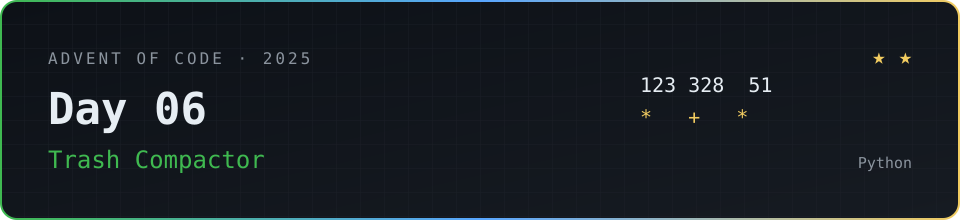
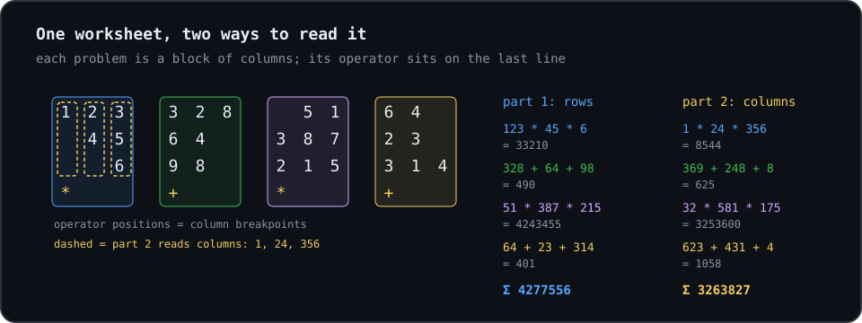

<div align="center">
  
</div>

> [!IMPORTANT]
> **The code was written 100% by a human.** Every line of the solutions in this repository was written by hand, without any kind of help from artificial intelligence: no generated code, no hints, no suggestions.
> AI was only used afterwards, to turn that finished, hand-written code into this README (the text and the diagrams).

## 🧩 The puzzle

A cephalopod's math worksheet is a set of problems laid out side by side. Each problem is a vertical stack of numbers with an operator (`+` or `*`) on the last line, and problems are separated by a column of spaces.

| Part | Question |
| :--: | -------- |
| ⭐ 1 | Reading each problem's numbers row by row, what is the sum of all the results? |
| ⭐ 2 | Cephalopod math is written in columns: each character column of a problem is one number, with its digits from top to bottom. What is the new grand total? |

## 💡 The idea

**Part 1** is just whitespace splitting: every line becomes a list of tokens, the last line gives the operators, and token `i` of every line belongs to problem `i`. The result of each problem is folded line by line with its operator.

**Part 2** needs the exact character positions, because the spaces inside a problem now matter. The trick in the code is that **each operator sits on the first column of its problem**, so the positions of the non-space characters in the operator line are the **breakpoints** between problems. Every number line is sliced at those breakpoints, and inside each slice the characters of column `i` are glued together (ignoring spaces) to form one number.

<div align="center">
  
</div>

Inside each slice the code builds the column numbers from left to right, and then folds them with the problem's operator.

## 🛠️ Implementations

| Language | Highlights |
| -------- | ---------- |
| [Python](./python) | Applies the operator through a small dictionary `{'*': ..., '+': ...}[op]`. Part 2 slices each line with `line[last:breakpoint - 1]` (dropping the blank separator column) and `get_numbers_from_column` concatenates the stripped characters of each column. The operator list parsed in part 1 is reused in part 2. |

```python
breakpoints = [i for i in range(len(operations_line)) if operations_line[i] != ' ']

for line in numbers_lines:
    split = []
    last = breakpoints[0]

    for breakpoint in breakpoints[1:]:
        split.append(line[last:breakpoint - 1])
        last = breakpoint

    split.append(line[last:])
```

## ⏱️ Complexity

For a worksheet with `c` characters:

| | Time | Memory |
| - | :--: | :----: |
| Part 1 | `O(c)` | `O(c)` |
| Part 2 | `O(c)` | `O(c)` |

## ▶️ Running

The script reads `./input.txt` from the current directory.

```bash
cd python && python3 main.py
```
