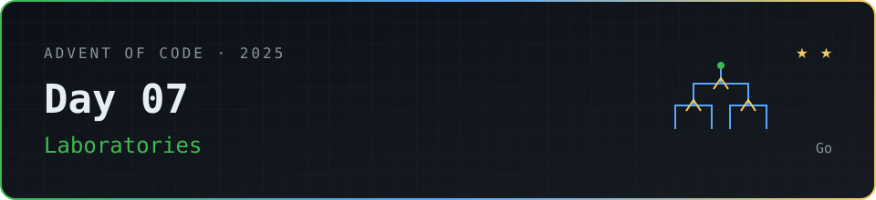
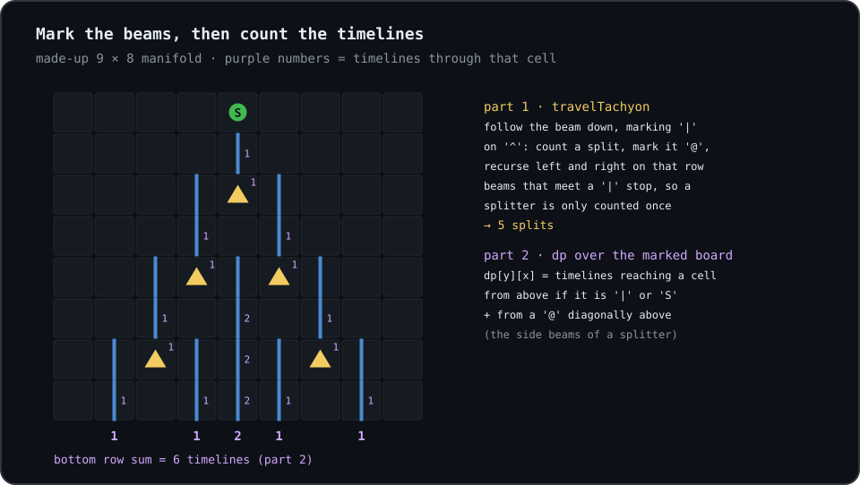

<div align="center">
  
</div>

> [!IMPORTANT]
> **The code was written 100% by a human.** Every line of the solutions in this repository was written by hand, without any kind of help from artificial intelligence: no generated code, no hints, no suggestions.
> AI was only used afterwards, to turn that finished, hand-written code into this README (the text and the diagrams).

## 🧩 The puzzle

A tachyon manifold is a grid. A beam enters at `S` and always moves down. Empty space (`.`) lets it pass; a splitter (`^`) stops it and sends out two new beams, from the cells right to its left and right, which also continue downwards.

| Part | Question |
| :--: | -------- |
| ⭐ 1 | How many times is the beam split? (Beams that end up in the same place merge, so each splitter counts once.) |
| ⭐ 2 | With a *quantum* manifold, a single particle takes **both** paths at every splitter, creating separate timelines. How many timelines are there at the end? |

## 💡 The idea

### Part 1: trace and mark

`travelTachyon` walks down from the start, writing `|` on every empty cell it crosses. When it reaches a `^`, it counts one split, rewrites the splitter as `@`, and recursively starts two new beams on the cells to the left and right of it. A beam stops as soon as it reaches a cell that is not empty, so a path that is already lit, or an already used splitter, is never counted twice.

### Part 2: count paths with dynamic programming

The marked board is now a map of every place a beam can be. `resolvePartTwo` sweeps it top to bottom keeping `dp[y][x]` = the number of timelines that reach that cell:

- a cell under `|` or `S` inherits the count from above;
- a cell diagonally below a used splitter `@` also receives that splitter's count (the beams that leave from its sides);
- a splitter takes the count from the beam above it.

The answer is the sum of the last row. Where beams merge, their counts add up, so the number of timelines can grow exponentially while the work stays linear.

<div align="center">
  
</div>

## 🛠️ Implementations

| Language | Highlights |
| -------- | ---------- |
| [Go](./go) | The board is a `[][]rune` that part 1 changes in place (`|` for beams, `@` for splitters that were hit); part 2 reads those marks instead of tracing the beams again. The input file is `./test.txt` unless a path is given as the first argument. |

```go
if t.board[y][startX] == '^' {
	t.splitsAmount += 1

	t.board[y][startX] = '@'

	t.travelTachyon(startX - 1, y)
	t.travelTachyon(startX + 1, y)

	break
}
```

## ⏱️ Complexity

For a grid with `n` cells:

| | Time | Memory |
| - | :--: | :----: |
| Part 1 | `O(n)` (each cell is lit at most once) | `O(n)` plus recursion depth |
| Part 2 | `O(n)` | `O(n)` for the dp table |

## ▶️ Running

```bash
cd go && go run . ../input.txt   # without an argument it reads ./test.txt
```
