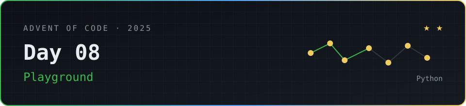
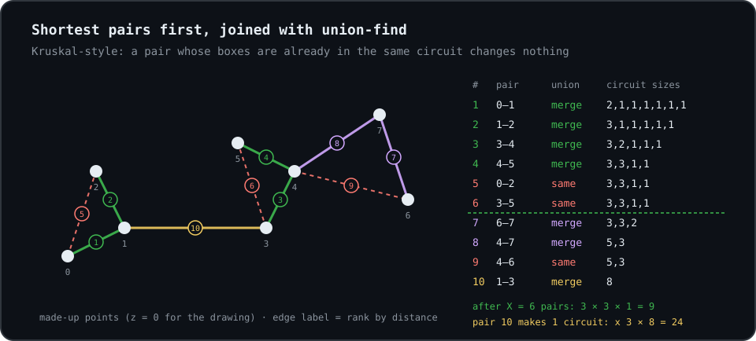

<div align="center">
  
</div>

> [!IMPORTANT]
> **The code was written 100% by a human.** Every line of the solutions in this repository was written by hand, without any kind of help from artificial intelligence: no generated code, no hints, no suggestions.
> AI was only used afterwards, to turn that finished, hand-written code into this README (the text and the diagrams).

## 🧩 The puzzle

The input is a list of junction boxes, one `X,Y,Z` position per line. The Elves connect pairs of boxes with lights, always choosing the two boxes that are **closest** (straight-line distance) and not connected yet. Boxes linked directly or through other boxes form a *circuit*.

| Part | Question |
| :--: | -------- |
| ⭐ 1 | After connecting the 1000 closest pairs, multiply the sizes of the three largest circuits. |
| ⭐ 2 | Keep connecting until all boxes are in one circuit. Multiply the `X` coordinates of the last two boxes connected. |

## 💡 The idea

This is **Kruskal's algorithm** for a minimum spanning tree, stopped at two different moments.

1. Compute the distance of every pair of boxes and sort the pairs from shortest to longest.
2. Walk through the pairs and join their circuits with a **union-find** (disjoint set) structure. If both boxes already share a root, the pair changes nothing.
3. **Part 1**: after the first `X` pairs, read the circuit sizes and multiply the three largest.
4. **Part 2**: keep going from pair `X + 1`. The union that brings the number of circuits down to `1` gives the answer.

<div align="center">
  
</div>

In this small made-up example with `X = 6`, the circuits after six pairs have sizes `3, 3, 1, 1`, and the 10th pair is the one that connects everything.

## 🛠️ Implementations

| Language | Highlights |
| -------- | ---------- |
| [Python](./python) | Builds the full list of `(distance, i, j, ...)` tuples with `math.sqrt` and sorts it. `find` uses **path compression** and `union` uses **union by size**, keeping a `circuit_size` list and a counter of circuits. Part 2 is detected inside `union` the moment the counter reaches `1`. The file name and `X` are set at the top of the script, with the test values (`./test.txt`, `X = 10`) kept as comments. |

```python
def find(i):
  if parent[i] == i: # is its own root
    return i
  parent[i] = find(parent[i]) # path compression, climb the tree to the upper most parent
  return parent[i]
```

## ⏱️ Complexity

For `n` boxes there are `n(n−1)/2` pairs:

| | Time | Memory |
| - | :--: | :----: |
| Part 1 | `O(n² log n)` (dominated by sorting the pairs) | `O(n²)` |
| Part 2 | `O(n² · α(n))` for the remaining unions | `O(n²)` |

## ▶️ Running

The script reads `./input.txt` from the current directory.

```bash
cd python && python3 main.py
```
